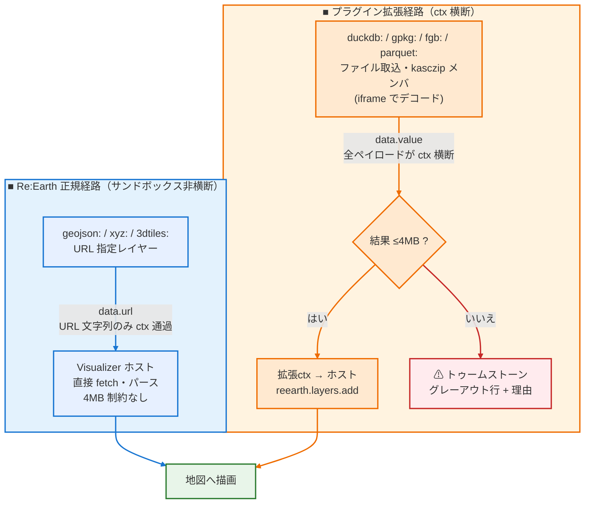

# ペイロード制限（QuickJS OOM 対策）

> **基本的にはこの制約を受けません。** `geojson:`/`xyz:`/`3dtiles:`/`base:` など URL 指定レイヤーは Re:Earth 正規経路（`data.url`）で Visualizer ホスト側が直接 fetch・パースするため、本ページの上限は一切関係ありません。制約が掛かるのは**プラグイン拡張経路**（iframe でデコード→`data.value` 注入）だけであり、**これは Cesium・ブラウザ・GeoJSON 仕様の制限ではなく、Re:Earth Visualizer のプラグインサンドボックス固有の上限です**（Cesium 本体ははるかに大きなデータを描画できます）。

Re:Earth のプラグイン拡張は QuickJS wasm コンテキストで実行され、**全拡張が同一の wasm linear memory を共有**します。コンテキスト間・iframe 間のメッセージはすべて `JSON.stringify → wasm メモリへの文字列コピー → ctx 内 JSON.parse` でマーシャルされるため、巨大なペイロードは共有ヒープを圧迫し、1拡張の OOM で拡張コンテキストが全滅します（`InternalError: out of memory` / `memory access out of bounds`、`Proxy.unwrapResult` で観測）。

つまり**制約がかかるのは「拡張コンテキストを横断するデータ」だけ**です。`data.url` は URL 文字列だけが ctx を通り本体はホスト側で処理されるため 4MB 制限の対象外（ベクター検索インデックスだけは別途予算制約あり）。制限が掛かるのは iframe でデコード→`data.value` として注入する経路です。

このため GeoSuite 側には以下の**明示的な上限**があります。上限を超えたレイヤは追加されず、レイヤ一覧に理由付きのグレーアウト行（トゥームストーン）として残ります。

## 数値上限（v21.3.3〜）

| 制限 | 値 | 場所 | 意味 |
|---|---|---|---|
| デコード済み GeoJSON（iframe→ctx） | **4MB**（JSON.stringify 長） | iframe 側 `gjTooBig`（layers-and-tiles-list / basemap-widget の各 decoder reply、全て同値） | ctx への流入そのものを遮断。超過時は `layer too large (XMB decoded, >4MB)` を返す |
| GeoJSON（ctx→`reearth.layers.add/override`） | **4MB** | ctx 側 `geojsonMsgTooBig` / `GEOJSON_MSG_MAX_BYTES` | ホストブリッジへの再マーシャルでの OOM 死亡を防止（iframe 側と同値のため通常はここに到達しない防衛線） |
| ドロップ .zip の eager メンバ合計 | **8MB**（バイト） | iframe `zipToKascResult(eager=true)` | base64 化すると ~10.7MB になり ctx を通るため。超過時は `zip members too large for file drop (XMB > 8MB)` |
| デコード結果の待機 TTL | **300s** | ctx `armPendingTtl`（qml/geojson/duckdb/gpkg/sql/fgb/parquet/kasczip + streetview/places 全 pending マップ） | ホスト ctx の OOM 死亡・iframe 再生成で結果が永遠に来ない場合に pending を解放し AI 呼出しへエラー返却 |
| AI/ブリッジツール結果 | **4MB**（JSON.stringify 長） | `aiToolReply`（パネル→ai-chat）・`capToolResult`（ai-chat→iframe/bridgeResult） | `captureView` の dataURL 等大きな結果が拡張ctx を通る際の OOM をエラー返却に変更 |
| ベクター検索インデックス（`vectorFeatureData`） | 1ソース **4MB** / 合計 **8MB** | iframe `requestVectorFeatureData` ハンドラ | 超過ソースは `tooLarge` マーカーに置換され検索対象から除外（レイヤ自体は地図上に生存） |

## ルーティング上の制約

- **eager `dataB64`（ドロップ zip メンバ）は basemap-widget 拡張ctx を中継しない**。`ddbPost`/`gpkgPost` は `payload.dataB64` がある場合ホスト経由をスキップし、自 iframe で直接デコードする。URL 由来・lazy kasczip メンバ（`zipId/zipUrl/zipPath`）のみホスト経由
- **URL 経由の kasczip メンバはバイトを ctx に通さない**。デコード側 iframe が `zipOrB64`/`_zipCache` で zip 自体を再 fetch して解凍する（`_zipCache` は iframe 内に閉じる）
- `duckdb:` 行のホスト wasm ウォームは eager メンバのみの構成では送らない（自 iframe 経路のため不要）
- **ベクター検索の value レイヤは ctx 内で直接インデックス化**（v21.3.3〜）。`computed.features` 未取得時、従来は `l.data.value` を iframe へ往復させていた（2回横断）が、`buildVectorFeatureIndexFromLayers` が geojson オブジェクト/文字列・csv テキスト/配列を ctx 内で直接変換する（1回の読込のみ）。URL ソースのみ iframe 経由の raw fetch（上記予算ガード付き）

## トゥームストーン（グレーアウト行）の仕様

上限超過・デコード不達はエラーログだけでなく、レイヤ一覧に `⚠ <タイトル>` + 赤い理由テキスト + 無効化チェックボックス + `×` ボタンの行として残ります。

- 記録されるケース: ctx 4MB ガード超過（ddb/gpkg/fgb/pq/geojson/import）、iframe 4MB デコード超過、ドロップ zip メンバ超過（`qgis:`/取込の `kascZipResult` エラー全般）、TTL タイムアウト、インポート失敗全般（非対応形式・デコード失敗）
- 消去条件: 同一ソース（URL/ファイル名）の再ロード開始時、`qgis:` 取込成功時、`×` による手動削除。パネル再描画（`safeShowUI`）を跨いで持続
- **記録しないケース**: `qml` スタイルコンパイルの失敗/タイムアウト（デフォルトスタイルへフォールバックしレイヤ自体は追加されるため）、`zip member not loaded`（zip 未到着の一時状態）、`refresh` 系クエリの一般エラー（レイヤは stale のまま地図上に生存）— ただし refresh でも **4MB ガード超過は記録する**（上限超過の可視化）。ベクター検索の `tooLarge` 除外はレイヤ追加の失敗ではないため記録しない（検索 UI に出ないだけ）

## 未解決の残存リスク

- `memoryLimitBytes` は Re:Earth ランタイム側の設定で、プラグインからは変更不可
- `computed.features` の属性走査自体は ctx 内で行うため、巨大レイヤのインデックス構築は依然として重い（上限内で済む設計だが、極端に多いユニーク値ではヒープ圧力が残る可能性）

## 回避策（ユーザー向け）

- 上限を超えるデータは **`qgis: <.kasc URL>` でホスト側に置いて取り込む**（DATA/ を外部ホストし、メンバは lazy fetch）。ドロップ zip ではなく URL 参照にすることでバイト列が ctx を通らなくなる
- クエリ結果が大きい場合は `where=`/`limit=`/`columns=`/`bbox=auto` で絞る
