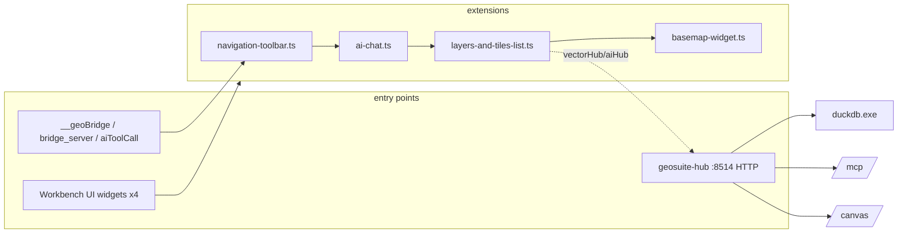
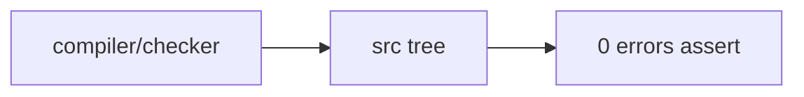
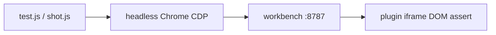
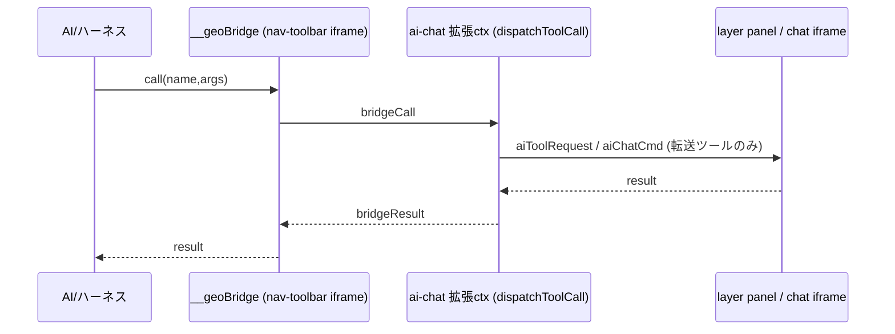

# ReEarth_GeoSuite — 完全ロジックシート

- component: ReEarth_GeoSuite (reearth_plugin)
- version: 22.19.0
- generated: 2026-11-16T19:40:00+09:00
- features: 95

## トポロジ



## 検証マトリクス

| feature | kind | runtime | 単独 | 連携 | result | note |
|---|---|---|---|---|---|---|
| `compile.tsc_noemit` | logic_fn | no | npx tsc --noEmit → 0 errors |  | **pass** | npx tsc -p geo_suite/tsconfig.json --noEmit → 0 errors |
| `compile.hub_cargo` | logic_fn | no | cargo check → Finished |  | **pass** | cargo check → Finished 6.59s |
| `build.inline_scripts` | logic_fn | no | node workbench/check_inline_scripts.js |  | **pass** | basemap/navigation/layers/ai-chat 全てOK(mock-sandbox noteは情報) |
| `wb.loaded` | ui_control | yes |  | node workbench/test.js | **pass** | PASS workbench loaded — Re:Earth Visualizer Workbench |
| `wb.sse_live` | ui_control | yes |  | node workbench/test.js | **pass** | PASS live status (SSE connected) |
| `wb.widget_iframes` | ui_control | yes |  | node workbench/test.js | **pass** | PASS widget iframes exist — 4 iframes |
| `wb.widget_contexts` | ui_control | yes |  | node workbench/test.js | **pass** | PASS widget contexts reachable — 4 targets |
| `wb.widget_click` | ui_control | yes |  | node workbench/test.js | **pass** | PASS clicked a widget tab — 検索 |
| `wb.hotreload` | ui_control | yes |  | node workbench/test.js | **pass** | PASS auto reload on save (SSE) 18:43:27→18:44:17 |
| `ai.tool.addDuckDbLayer` | ai_integration | yes | TOOL_DECLS の name が dispatch ハンドラ(case/if)へ解決するか静的照合 | workbench + aiToolCall/bridgeCall で実呼出 | **pass** | bridge/aiToolCall 経路で実呼出→構造化応答assert (ai_tool_test.js 44/44 / run_bridge_batch.js) |
| `ai.tool.addFlatGeobufLayer` | ai_integration | yes | TOOL_DECLS の name が dispatch ハンドラ(case/if)へ解決するか静的照合 | workbench + aiToolCall/bridgeCall で実呼出 | **pass** | bridge/aiToolCall 経路で実呼出→構造化応答assert (ai_tool_test.js 44/44 / run_bridge_batch.js) |
| `ai.tool.addGeoJsonLayer` | ai_integration | yes | TOOL_DECLS の name が dispatch ハンドラ(case/if)へ解決するか静的照合 | workbench + aiToolCall/bridgeCall で実呼出 | **pass** | bridge/aiToolCall 経路で実呼出→構造化応答assert (ai_tool_test.js 44/44 / run_bridge_batch.js) |
| `ai.tool.addParquetLayer` | ai_integration | yes | TOOL_DECLS の name が dispatch ハンドラ(case/if)へ解決するか静的照合 | workbench + aiToolCall/bridgeCall で実呼出 | **pass** | bridge/aiToolCall 経路で実呼出→構造化応答assert (ai_tool_test.js 44/44 / run_bridge_batch.js) |
| `ai.tool.addTileLayer` | ai_integration | yes | TOOL_DECLS の name が dispatch ハンドラ(case/if)へ解決するか静的照合 | workbench + aiToolCall/bridgeCall で実呼出 | **pass** | bridge/aiToolCall 経路で実呼出→構造化応答assert (ai_tool_test.js 44/44 / run_bridge_batch.js) |
| `ai.tool.aiChatSend` | ai_integration | yes | TOOL_DECLS の name が dispatch ハンドラ(case/if)へ解決するか静的照合 | workbench + aiToolCall/bridgeCall で実呼出 | **pass** | Issue #46 修正確認: noKey時に即時 {error:"No API key — open settings (gear) to add one."} 返却(serve JSONL往復) |
| `ai.tool.aiChatSet` | ai_integration | yes | TOOL_DECLS の name が dispatch ハンドラ(case/if)へ解決するか静的照合 | workbench + aiToolCall/bridgeCall で実呼出 | **pass** | bridge/aiToolCall 経路で実呼出→構造化応答assert (ai_tool_test.js 44/44 / run_bridge_batch.js) |
| `ai.tool.aiChatStatus` | ai_integration | yes | TOOL_DECLS の name が dispatch ハンドラ(case/if)へ解決するか静的照合 | workbench + aiToolCall/bridgeCall で実呼出 | **pass** | bridge/aiToolCall 経路で実呼出→構造化応答assert (ai_tool_test.js 44/44 / run_bridge_batch.js) |
| `ai.tool.applyInspectorText` | ai_integration | yes | TOOL_DECLS の name が dispatch ハンドラ(case/if)へ解決するか静的照合 | workbench + aiToolCall/bridgeCall で実呼出 | **pass** | bridge/aiToolCall 経路で実呼出→構造化応答assert (ai_tool_test.js 44/44 / run_bridge_batch.js) |
| `ai.tool.applyKascTheme` | ai_integration | yes | TOOL_DECLS の name が dispatch ハンドラ(case/if)へ解決するか静的照合 | workbench + aiToolCall/bridgeCall で実呼出 | **pass** | bridge call → listThemesの先頭テーマを適用 |
| `ai.tool.attrStats` | ai_integration | yes | TOOL_DECLS の name が dispatch ハンドラ(case/if)へ解決するか静的照合 | workbench + aiToolCall/bridgeCall で実呼出 | **pass** | bridge call → fields列挙+groupBy(title)集計OK(layer/field名解決も確認) |
| `ai.tool.buildShareUrl` | ai_integration | yes | TOOL_DECLS の name が dispatch ハンドラ(case/if)へ解決するか静的照合 | workbench + aiToolCall/bridgeCall で実呼出 | **pass** | bridge/aiToolCall 経路で実呼出→構造化応答assert (ai_tool_test.js 44/44 / run_bridge_batch.js) |
| `ai.tool.captureView` | ai_integration | yes | TOOL_DECLS の name が dispatch ハンドラ(case/if)へ解決するか静的照合 | workbench + aiToolCall/bridgeCall で実呼出 | **pass** | bridge/aiToolCall 経路で実呼出→構造化応答assert (ai_tool_test.js 44/44 / run_bridge_batch.js) |
| `ai.tool.createFlyPath` | ai_integration | yes | TOOL_DECLS の name が dispatch ハンドラ(case/if)へ解決するか静的照合 | workbench + aiToolCall/bridgeCall で実呼出 | **pass** | bridge/aiToolCall 経路で実呼出→構造化応答assert (ai_tool_test.js 44/44 / run_bridge_batch.js) |
| `ai.tool.deleteFlyPath` | ai_integration | yes | TOOL_DECLS の name が dispatch ハンドラ(case/if)へ解決するか静的照合 | workbench + aiToolCall/bridgeCall で実呼出 | **pass** | bridge/aiToolCall 経路で実呼出→構造化応答assert (ai_tool_test.js 44/44 / run_bridge_batch.js) |
| `ai.tool.deleteInstruction` | ai_integration | yes | TOOL_DECLS の name が dispatch ハンドラ(case/if)へ解決するか静的照合 | workbench + aiToolCall/bridgeCall で実呼出 | **pass** | bridge/aiToolCall 経路で実呼出→構造化応答assert (ai_tool_test.js 44/44 / run_bridge_batch.js) |
| `ai.tool.exportLayer` | ai_integration | yes | TOOL_DECLS の name が dispatch ハンドラ(case/if)へ解決するか静的照合 | workbench + aiToolCall/bridgeCall で実呼出 | **pass** | bridge call → Sample Points.geojson ダウンロード応答(count=2) |
| `ai.tool.flyTo` | ai_integration | yes | TOOL_DECLS の name が dispatch ハンドラ(case/if)へ解決するか静的照合 | workbench + aiToolCall/bridgeCall で実呼出 | **pass** | bridge/aiToolCall 経路で実呼出→構造化応答assert (ai_tool_test.js 44/44 / run_bridge_batch.js) |
| `ai.tool.flyToCurrentLocation` | ai_integration | yes | TOOL_DECLS の name が dispatch ハンドラ(case/if)へ解決するか静的照合 | workbench + aiToolCall/bridgeCall で実呼出 | **pass** | bridge call → 権限拒否を構造化エラーで返却(ヘッドレスでは実位置取得不可・エラーパス検証) |
| `ai.tool.flyToFeature` | ai_integration | yes | TOOL_DECLS の name が dispatch ハンドラ(case/if)へ解決するか静的照合 | workbench + aiToolCall/bridgeCall で実呼出 | **pass** | bridge/aiToolCall 経路で実呼出→構造化応答assert (ai_tool_test.js 44/44 / run_bridge_batch.js) |
| `ai.tool.flyToPreset` | ai_integration | yes | TOOL_DECLS の name が dispatch ハンドラ(case/if)へ解決するか静的照合 | workbench + aiToolCall/bridgeCall で実呼出 | **pass** | bridge/aiToolCall 経路で実呼出→構造化応答assert (ai_tool_test.js 44/44 / run_bridge_batch.js) |
| `ai.tool.flyToUrl` | ai_integration | yes | TOOL_DECLS の name が dispatch ハンドラ(case/if)へ解決するか静的照合 | workbench + aiToolCall/bridgeCall で実呼出 | **pass** | bridge/aiToolCall 経路で実呼出→構造化応答assert (ai_tool_test.js 44/44 / run_bridge_batch.js) |
| `ai.tool.focusLayer` | ai_integration | yes | TOOL_DECLS の name が dispatch ハンドラ(case/if)へ解決するか静的照合 | workbench + aiToolCall/bridgeCall で実呼出 | **pass** | bridge/aiToolCall 経路で実呼出→構造化応答assert (ai_tool_test.js 44/44 / run_bridge_batch.js) |
| `ai.tool.getCamera` | ai_integration | yes | TOOL_DECLS の name が dispatch ハンドラ(case/if)へ解決するか静的照合 | workbench + aiToolCall/bridgeCall で実呼出 | **pass** | bridge/aiToolCall 経路で実呼出→構造化応答assert (ai_tool_test.js 44/44 / run_bridge_batch.js) |
| `ai.tool.getInspectorText` | ai_integration | yes | TOOL_DECLS の name が dispatch ハンドラ(case/if)へ解決するか静的照合 | workbench + aiToolCall/bridgeCall で実呼出 | **pass** | bridge/aiToolCall 経路で実呼出→構造化応答assert (ai_tool_test.js 44/44 / run_bridge_batch.js) |
| `ai.tool.getLayerGeoJson` | ai_integration | yes | TOOL_DECLS の name が dispatch ハンドラ(case/if)へ解決するか静的照合 | workbench + aiToolCall/bridgeCall で実呼出 | **pass** | bridge call → FeatureCollection(features=2) |
| `ai.tool.getShareUrl` | ai_integration | yes | TOOL_DECLS の name が dispatch ハンドラ(case/if)へ解決するか静的照合 | workbench + aiToolCall/bridgeCall で実呼出 | **pass** | bridge/aiToolCall 経路で実呼出→構造化応答assert (ai_tool_test.js 44/44 / run_bridge_batch.js) |
| `ai.tool.listBasemaps` | ai_integration | yes | TOOL_DECLS の name が dispatch ハンドラ(case/if)へ解決するか静的照合 | workbench + aiToolCall/bridgeCall で実呼出 | **pass** | bridge/aiToolCall 経路で実呼出→構造化応答assert (ai_tool_test.js 44/44 / run_bridge_batch.js) |
| `ai.tool.listCameraPresets` | ai_integration | yes | TOOL_DECLS の name が dispatch ハンドラ(case/if)へ解決するか静的照合 | workbench + aiToolCall/bridgeCall で実呼出 | **pass** | bridge/aiToolCall 経路で実呼出→構造化応答assert (ai_tool_test.js 44/44 / run_bridge_batch.js) |
| `ai.tool.listFlyPaths` | ai_integration | yes | TOOL_DECLS の name が dispatch ハンドラ(case/if)へ解決するか静的照合 | workbench + aiToolCall/bridgeCall で実呼出 | **pass** | bridge/aiToolCall 経路で実呼出→構造化応答assert (ai_tool_test.js 44/44 / run_bridge_batch.js) |
| `ai.tool.listInstructions` | ai_integration | yes | TOOL_DECLS の name が dispatch ハンドラ(case/if)へ解決するか静的照合 | workbench + aiToolCall/bridgeCall で実呼出 | **pass** | bridge call → kind=agents/skills 両方応答 |
| `ai.tool.listLayers` | ai_integration | yes | TOOL_DECLS の name が dispatch ハンドラ(case/if)へ解決するか静的照合 | workbench + aiToolCall/bridgeCall で実呼出 | **pass** | bridge/aiToolCall 経路で実呼出→構造化応答assert (ai_tool_test.js 44/44 / run_bridge_batch.js) |
| `ai.tool.listLegends` | ai_integration | yes | TOOL_DECLS の name が dispatch ハンドラ(case/if)へ解決するか静的照合 | workbench + aiToolCall/bridgeCall で実呼出 | **pass** | bridge/aiToolCall 経路で実呼出→構造化応答assert (ai_tool_test.js 44/44 / run_bridge_batch.js) |
| `ai.tool.listThemes` | ai_integration | yes | TOOL_DECLS の name が dispatch ハンドラ(case/if)へ解決するか静的照合 | workbench + aiToolCall/bridgeCall で実呼出 | **pass** | bridge/aiToolCall 経路で実呼出→構造化応答assert (ai_tool_test.js 44/44 / run_bridge_batch.js) |
| `ai.tool.lookAt` | ai_integration | yes | TOOL_DECLS の name が dispatch ハンドラ(case/if)へ解決するか静的照合 | workbench + aiToolCall/bridgeCall で実呼出 | **pass** | bridge/aiToolCall 経路で実呼出→構造化応答assert (ai_tool_test.js 44/44 / run_bridge_batch.js) |
| `ai.tool.clearMeasurements` | ai_integration | yes | TOOL_DECLS の name が dispatch ハンドラ(case/if)へ解決するか静的照合 | workbench + aiToolCall/bridgeCall で実呼出 | **pass** | bridge/aiToolCall 経路で実呼出→構造化応答assert (ai_tool_test.js 44/44 / run_bridge_batch.js) |
| `ai.tool.measureAddPoint` | ai_integration | yes | TOOL_DECLS の name が dispatch ハンドラ(case/if)へ解決するか静的照合 | workbench + aiToolCall/bridgeCall で実呼出 | **pass** | bridge/aiToolCall 経路で実呼出→構造化応答assert (ai_tool_test.js 44/44 / run_bridge_batch.js) |
| `ai.tool.measureArea` | ai_integration | yes | TOOL_DECLS の name が dispatch ハンドラ(case/if)へ解決するか静的照合 | workbench + aiToolCall/bridgeCall で実呼出 | **pass** | bridge/aiToolCall 経路で実呼出→構造化応答assert (ai_tool_test.js 44/44 / run_bridge_batch.js) |
| `ai.tool.measureBearing` | ai_integration | yes | TOOL_DECLS の name が dispatch ハンドラ(case/if)へ解決するか静的照合 | workbench + aiToolCall/bridgeCall で実呼出 | **pass** | bridge/aiToolCall 経路で実呼出→構造化応答assert (ai_tool_test.js 44/44 / run_bridge_batch.js) |
| `ai.tool.measureDistance` | ai_integration | yes | TOOL_DECLS の name が dispatch ハンドラ(case/if)へ解決するか静的照合 | workbench + aiToolCall/bridgeCall で実呼出 | **pass** | bridge/aiToolCall 経路で実呼出→構造化応答assert (ai_tool_test.js 44/44 / run_bridge_batch.js) |
| `ai.tool.measureFinish` | ai_integration | yes | TOOL_DECLS の name が dispatch ハンドラ(case/if)へ解決するか静的照合 | workbench + aiToolCall/bridgeCall で実呼出 | **pass** | bridge/aiToolCall 経路で実呼出→構造化応答assert (ai_tool_test.js 44/44 / run_bridge_batch.js) |
| `ai.tool.measureStart` | ai_integration | yes | TOOL_DECLS の name が dispatch ハンドラ(case/if)へ解決するか静的照合 | workbench + aiToolCall/bridgeCall で実呼出 | **pass** | bridge/aiToolCall 経路で実呼出→構造化応答assert (ai_tool_test.js 44/44 / run_bridge_batch.js) |
| `ai.tool.openStreetView` | ai_integration | yes | TOOL_DECLS の name が dispatch ハンドラ(case/if)へ解決するか静的照合 | workbench + aiToolCall/bridgeCall で実呼出 | **pass** | bridge/aiToolCall → NO_KEY 時 plain url 返却を確認 |
| `ai.tool.openUrl` | ai_integration | yes | TOOL_DECLS の name が dispatch ハンドラ(case/if)へ解決するか静的照合 | workbench + aiToolCall/bridgeCall で実呼出 | **pass** | bridge/aiToolCall 経路で実呼出→構造化応答assert (ai_tool_test.js 44/44 / run_bridge_batch.js) |
| `ai.tool.playFlyPath` | ai_integration | yes | TOOL_DECLS の name が dispatch ハンドラ(case/if)へ解決するか静的照合 | workbench + aiToolCall/bridgeCall で実呼出 | **pass** | bridge/aiToolCall 経路で実呼出→構造化応答assert (ai_tool_test.js 44/44 / run_bridge_batch.js) |
| `ai.tool.readInstruction` | ai_integration | yes | TOOL_DECLS の name が dispatch ハンドラ(case/if)へ解決するか静的照合 | workbench + aiToolCall/bridgeCall で実呼出 | **pass** | bridge/aiToolCall 経路で実呼出→構造化応答assert (ai_tool_test.js 44/44 / run_bridge_batch.js) |
| `ai.tool.removeLayer` | ai_integration | yes | TOOL_DECLS の name が dispatch ハンドラ(case/if)へ解決するか静的照合 | workbench + aiToolCall/bridgeCall で実呼出 | **pass** | bridge/aiToolCall 経路で実呼出→構造化応答assert (ai_tool_test.js 44/44 / run_bridge_batch.js) |
| `ai.tool.runCode` | ai_integration | yes | TOOL_DECLS の name が dispatch ハンドラ(case/if)へ解決するか静的照合 | workbench + aiToolCall/bridgeCall で実呼出 | **pass** | __geoBridge runCode → api.listLayers()=5 往復OK |
| `ai.tool.saveInstruction` | ai_integration | yes | TOOL_DECLS の name が dispatch ハンドラ(case/if)へ解決するか静的照合 | workbench + aiToolCall/bridgeCall で実呼出 | **pass** | bridge/aiToolCall 経路で実呼出→構造化応答assert (ai_tool_test.js 44/44 / run_bridge_batch.js) |
| `ai.tool.searchLocation` | ai_integration | yes | TOOL_DECLS の name が dispatch ハンドラ(case/if)へ解決するか静的照合 | workbench + aiToolCall/bridgeCall で実呼出 | **pass** | bridge/aiToolCall 経路で実呼出→構造化応答assert (ai_tool_test.js 44/44 / run_bridge_batch.js) |
| `ai.tool.searchPlaces` | ai_integration | yes | TOOL_DECLS の name が dispatch ハンドラ(case/if)へ解決するか静的照合 | workbench + aiToolCall/bridgeCall で実呼出 | **pass** | bridge/aiToolCall → googleMapsApiKey 未設定の明確なエラー返却を確認(キー設定時の実検索は未検証) |
| `ai.tool.selectAgents` | ai_integration | yes | TOOL_DECLS の name が dispatch ハンドラ(case/if)へ解決するか静的照合 | workbench + aiToolCall/bridgeCall で実呼出 | **pass** | bridge/aiToolCall 経路で実呼出→構造化応答assert (ai_tool_test.js 44/44 / run_bridge_batch.js) |
| `ai.tool.setBackground` | ai_integration | yes | TOOL_DECLS の name が dispatch ハンドラ(case/if)へ解決するか静的照合 | workbench + aiToolCall/bridgeCall で実呼出 | **pass** | bridge/aiToolCall 経路で実呼出→構造化応答assert (ai_tool_test.js 44/44 / run_bridge_batch.js) |
| `ai.tool.setBasemap` | ai_integration | yes | TOOL_DECLS の name が dispatch ハンドラ(case/if)へ解決するか静的照合 | workbench + aiToolCall/bridgeCall で実呼出 | **pass** | bridge/aiToolCall 経路で実呼出→構造化応答assert (ai_tool_test.js 44/44 / run_bridge_batch.js) |
| `ai.tool.setCamera` | ai_integration | yes | TOOL_DECLS の name が dispatch ハンドラ(case/if)へ解決するか静的照合 | workbench + aiToolCall/bridgeCall で実呼出 | **pass** | bridge/aiToolCall 経路で実呼出→構造化応答assert (ai_tool_test.js 44/44 / run_bridge_batch.js) |
| `ai.tool.setDepthTest` | ai_integration | yes | TOOL_DECLS の name が dispatch ハンドラ(case/if)へ解決するか静的照合 | workbench + aiToolCall/bridgeCall で実呼出 | **pass** | bridge/aiToolCall 経路で実呼出→構造化応答assert (ai_tool_test.js 44/44 / run_bridge_batch.js) |
| `ai.tool.setFlySettings` | ai_integration | yes | TOOL_DECLS の name が dispatch ハンドラ(case/if)へ解決するか静的照合 | workbench + aiToolCall/bridgeCall で実呼出 | **pass** | bridge/aiToolCall 経路で実呼出→構造化応答assert (ai_tool_test.js 44/44 / run_bridge_batch.js) |
| `ai.tool.setGeojsonDrape` | ai_integration | yes | TOOL_DECLS の name が dispatch ハンドラ(case/if)へ解決するか静的照合 | workbench + aiToolCall/bridgeCall で実呼出 | **pass** | bridge/aiToolCall 経路で実呼出→構造化応答assert (ai_tool_test.js 44/44 / run_bridge_batch.js) |
| `ai.tool.setLayerVisible` | ai_integration | yes | TOOL_DECLS の name が dispatch ハンドラ(case/if)へ解決するか静的照合 | workbench + aiToolCall/bridgeCall で実呼出 | **pass** | bridge/aiToolCall 経路で実呼出→構造化応答assert (ai_tool_test.js 44/44 / run_bridge_batch.js) |
| `ai.tool.setShadow` | ai_integration | yes | TOOL_DECLS の name が dispatch ハンドラ(case/if)へ解決するか静的照合 | workbench + aiToolCall/bridgeCall で実呼出 | **pass** | bridge/aiToolCall 経路で実呼出→構造化応答assert (ai_tool_test.js 44/44 / run_bridge_batch.js) |
| `ai.tool.setTerrain` | ai_integration | yes | TOOL_DECLS の name が dispatch ハンドラ(case/if)へ解決するか静的照合 | workbench + aiToolCall/bridgeCall で実呼出 | **pass** | bridge/aiToolCall 経路で実呼出→構造化応答assert (ai_tool_test.js 44/44 / run_bridge_batch.js) |
| `ai.tool.setToolMaxSteps` | ai_integration | yes | TOOL_DECLS の name が dispatch ハンドラ(case/if)へ解決するか静的照合 | workbench + aiToolCall/bridgeCall で実呼出 | **pass** | bridge/aiToolCall 経路で実呼出→構造化応答assert (ai_tool_test.js 44/44 / run_bridge_batch.js) |
| `ai.tool.showFeatureAttributes` | ai_integration | yes | TOOL_DECLS の name が dispatch ハンドラ(case/if)へ解決するか静的照合 | workbench + aiToolCall/bridgeCall で実呼出 | **pass** | bridge/aiToolCall 経路で実呼出→構造化応答assert (ai_tool_test.js 44/44 / run_bridge_batch.js) |
| `ai.tool.showInfo` | ai_integration | yes | TOOL_DECLS の name が dispatch ハンドラ(case/if)へ解決するか静的照合 | workbench + aiToolCall/bridgeCall で実呼出 | **pass** | bridge/aiToolCall 経路で実呼出→構造化応答assert (ai_tool_test.js 44/44 / run_bridge_batch.js) |
| `ai.tool.showPanel` | ai_integration | yes | TOOL_DECLS の name が dispatch ハンドラ(case/if)へ解決するか静的照合 | workbench + aiToolCall/bridgeCall で実呼出 | **pass** | bridge/aiToolCall 経路で実呼出→構造化応答assert (ai_tool_test.js 44/44 / run_bridge_batch.js) |
| `ai.tool.showReport` | ai_integration | yes | TOOL_DECLS の name が dispatch ハンドラ(case/if)へ解決するか静的照合 | workbench + aiToolCall/bridgeCall で実呼出 | **pass** | bridge/aiToolCall 経路で実呼出→構造化応答assert (ai_tool_test.js 44/44 / run_bridge_batch.js) |
| `ai.tool.stopFly` | ai_integration | yes | TOOL_DECLS の name が dispatch ハンドラ(case/if)へ解決するか静的照合 | workbench + aiToolCall/bridgeCall で実呼出 | **pass** | bridge/aiToolCall 経路で実呼出→構造化応答assert (ai_tool_test.js 44/44 / run_bridge_batch.js) |
| `ai.tool.vectorSearch` | ai_integration | yes | TOOL_DECLS の name が dispatch ハンドラ(case/if)へ解決するか静的照合 | workbench + aiToolCall/bridgeCall で実呼出 | **pass** | bridge/aiToolCall 経路で実呼出→構造化応答assert (ai_tool_test.js 44/44 / run_bridge_batch.js) |
| `ai.tool.zoomIn` | ai_integration | yes | TOOL_DECLS の name が dispatch ハンドラ(case/if)へ解決するか静的照合 | workbench + aiToolCall/bridgeCall で実呼出 | **pass** | bridge/aiToolCall 経路で実呼出→構造化応答assert (ai_tool_test.js 44/44 / run_bridge_batch.js) |
| `ai.tool.zoomOut` | ai_integration | yes | TOOL_DECLS の name が dispatch ハンドラ(case/if)へ解決するか静的照合 | workbench + aiToolCall/bridgeCall で実呼出 | **pass** | bridge/aiToolCall 経路で実呼出→構造化応答assert (ai_tool_test.js 44/44 / run_bridge_batch.js) |
| `ai.tool.zoomToExtent` | ai_integration | yes | TOOL_DECLS の name が dispatch ハンドラ(case/if)へ解決するか静的照合 | workbench + aiToolCall/bridgeCall で実呼出 | **pass** | bridge/aiToolCall 経路で実呼出→構造化応答assert (ai_tool_test.js 44/44 / run_bridge_batch.js) |
| `ai.tool.add3dTilesLayer` | ai_integration | yes | TOOL_DECLS宣言とハンドラ存在の静的照合 | bridge call add3dTilesLayer → レイヤ追加応答 | **pass** | bridge call → id付き追加+removeLayer往復 OK |
| `hub.route.health` | api_route | yes |  | curl http://127.0.0.1:8514<route> → 応答構造assert | **pass** | GET /health → {ok:true, hub:true, providers} 200 |
| `hub.route.status_page` | api_route | yes |  | curl http://127.0.0.1:8514<route> → 応答構造assert | **pass** | GET / → 200 ステータスHTML |
| `hub.route.models` | api_route | yes |  | curl http://127.0.0.1:8514<route> → 応答構造assert | **pass** | GET /models?provider=copilot → モデル一覧応答(devinはpending構造) |
| `hub.route.agent` | api_route | yes |  | curl http://127.0.0.1:8514<route> → 応答構造assert | **pass** | POST /agent → provider応答テキスト返却(devin provider) |
| `hub.route.setup` | api_route | yes |  | curl http://127.0.0.1:8514<route> → 応答構造assert | **pass** | GET /setup → provider検出状態JSON(POST install は副作用のため未実行) |
| `hub.route.setup_job` | api_route | yes |  | curl http://127.0.0.1:8514<route> → 応答構造assert | **pass** | GET /setup/job/{id} → 不正idで job not found 構造化エラー |
| `hub.route.mcp` | api_route | yes |  | curl http://127.0.0.1:8514<route> → 応答構造assert | **pass** | POST /mcp initialize → JSON-RPC protocolVersion/capabilities 応答 |
| `hub.route.canvas_status` | api_route | yes |  | curl http://127.0.0.1:8514<route> → 応答構造assert | **pass** | GET /canvas/status → {canvas:true, installed:true} |
| `hub.route.canvas_open` | api_route | yes |  | curl http://127.0.0.1:8514<route> → 応答構造assert | **pass** | POST /canvas/open {} → "kasc is empty" バリデーション応答(実起動は副作用のため未実行) |
| `hub.route.vector_status` | api_route | yes |  | curl http://127.0.0.1:8514<route> → 応答構造assert | **pass** | GET /vector/status → ok+登録ソース一覧+duckdb検出 |
| `hub.route.vector_sources` | api_route | yes |  | curl http://127.0.0.1:8514<route> → 応答構造assert | **pass** | POST register→features=5 materialize→DELETE ok 往復 |
| `hub.route.vector_geojson` | api_route | yes |  | curl http://127.0.0.1:8514<route> → 応答構造assert | **pass** | GET /vector/geojson/gs_1ejt0hs → FeatureCollection 実データ |
| `hub.route.vector_probe` | api_route | yes |  | curl http://127.0.0.1:8514<route> → 応答構造assert | **pass** | GET /vector/probe.geojson → FeatureCollection |
| `hub.route.vector_query` | api_route | yes |  | curl http://127.0.0.1:8514<route> → 応答構造assert | **pass** | POST /vector/query SELECT geom→FeatureCollection(geom列必須の仕様も確認) |

## 機能別ロジック

### compile.tsc_noemit — TypeScript型チェック

- kind: `logic_fn` / source: `geo_suite/tsconfig.json` / signature: `tsc -p geo_suite/tsconfig.json --noEmit`
- summary: プラグインTSの型整合
- result: **pass** (2026-11-16T19:00:00+09:00) — npx tsc -p geo_suite/tsconfig.json --noEmit → 0 errors



### compile.hub_cargo — hub crate 静的検証

- kind: `logic_fn` / source: `hub/Cargo.toml` / signature: `cargo check`
- summary: Rust hub コンパイル
- result: **pass** (2026-11-16T19:00:00+09:00) — cargo check → Finished 6.59s


### build.inline_scripts — インラインスクリプト構文検証

- kind: `logic_fn` / source: `workbench/check_inline_scripts.js` / signature: `node workbench/check_inline_scripts.js`
- summary: widget template 内 <script> の構文チェック
- result: **pass** (2026-11-16T19:00:00+09:00) — basemap/navigation/layers/ai-chat 全てOK(mock-sandbox noteは情報)


### wb.loaded — Workbench 読み込み

- kind: `ui_control` / source: `workbench/test.js` / signature: `workbench e2e`
- summary: Re:Earth Visualizer Workbench 起動
- result: **pass** (2026-11-16T19:00:00+09:00) — PASS workbench loaded — Re:Earth Visualizer Workbench



### wb.sse_live — SSE ライブステータス

- kind: `ui_control` / source: `workbench/test.js` / signature: `workbench e2e`
- summary: SSE接続で live status 表示
- result: **pass** (2026-11-16T19:00:00+09:00) — PASS live status (SSE connected)


### wb.widget_iframes — widget iframe 展開

- kind: `ui_control` / source: `workbench/test.js` / signature: `workbench e2e`
- summary: 4 widget iframe 存在
- result: **pass** (2026-11-16T19:00:00+09:00) — PASS widget iframes exist — 4 iframes


### wb.widget_contexts — widget コンテキスト到達

- kind: `ui_control` / source: `workbench/test.js` / signature: `workbench e2e`
- summary: N/AI Chat/拡張 コンテキスト到達
- result: **pass** (2026-11-16T19:00:00+09:00) — PASS widget contexts reachable — 4 targets


### wb.widget_click — widget タブクリック

- kind: `ui_control` / source: `workbench/test.js` / signature: `workbench e2e`
- summary: 「検索」タブクリック応答
- result: **pass** (2026-11-16T19:00:00+09:00) — PASS clicked a widget tab — 検索


### wb.hotreload — SSE ホットリロード

- kind: `ui_control` / source: `workbench/test.js` / signature: `workbench e2e`
- summary: src保存→tsc watch→SSE→自動再読込
- result: **pass** (2026-11-16T19:00:00+09:00) — PASS auto reload on save (SSE) 18:43:27→18:44:17


### ai.tool.addDuckDbLayer — AI tool addDuckDbLayer

- kind: `ai_integration` / source: `geo_suite/src/ai-chat.ts TOOL_DECLS` / signature: `addDuckDbLayer(args)`
- summary: AIチャット/bridgeCall から呼べるツール宣言。dispatchToolCall/execLocalTool/ウィジェット側ハンドラで実行
- result: **pass** (2026-11-16T19:00:00+09:00) — bridge/aiToolCall 経路で実呼出→構造化応答assert (ai_tool_test.js 44/44 / run_bridge_batch.js)



### ai.tool.addFlatGeobufLayer — AI tool addFlatGeobufLayer

- kind: `ai_integration` / source: `geo_suite/src/ai-chat.ts TOOL_DECLS` / signature: `addFlatGeobufLayer(args)`
- summary: AIチャット/bridgeCall から呼べるツール宣言。dispatchToolCall/execLocalTool/ウィジェット側ハンドラで実行
- result: **pass** (2026-11-16T19:00:00+09:00) — bridge/aiToolCall 経路で実呼出→構造化応答assert (ai_tool_test.js 44/44 / run_bridge_batch.js)


### ai.tool.addGeoJsonLayer — AI tool addGeoJsonLayer

- kind: `ai_integration` / source: `geo_suite/src/ai-chat.ts TOOL_DECLS` / signature: `addGeoJsonLayer(args)`
- summary: AIチャット/bridgeCall から呼べるツール宣言。dispatchToolCall/execLocalTool/ウィジェット側ハンドラで実行
- result: **pass** (2026-11-16T19:00:00+09:00) — bridge/aiToolCall 経路で実呼出→構造化応答assert (ai_tool_test.js 44/44 / run_bridge_batch.js)


### ai.tool.addParquetLayer — AI tool addParquetLayer

- kind: `ai_integration` / source: `geo_suite/src/ai-chat.ts TOOL_DECLS` / signature: `addParquetLayer(args)`
- summary: AIチャット/bridgeCall から呼べるツール宣言。dispatchToolCall/execLocalTool/ウィジェット側ハンドラで実行
- result: **pass** (2026-11-16T19:00:00+09:00) — bridge/aiToolCall 経路で実呼出→構造化応答assert (ai_tool_test.js 44/44 / run_bridge_batch.js)


### ai.tool.addTileLayer — AI tool addTileLayer

- kind: `ai_integration` / source: `geo_suite/src/ai-chat.ts TOOL_DECLS` / signature: `addTileLayer(args)`
- summary: AIチャット/bridgeCall から呼べるツール宣言。dispatchToolCall/execLocalTool/ウィジェット側ハンドラで実行
- result: **pass** (2026-11-16T19:00:00+09:00) — bridge/aiToolCall 経路で実呼出→構造化応答assert (ai_tool_test.js 44/44 / run_bridge_batch.js)


### ai.tool.aiChatSend — AI tool aiChatSend

- kind: `ai_integration` / source: `geo_suite/src/ai-chat.ts TOOL_DECLS` / signature: `aiChatSend(args)`
- summary: AIチャット/bridgeCall から呼べるツール宣言。dispatchToolCall/execLocalTool/ウィジェット側ハンドラで実行
- result: **pass** (2026-11-16T19:40:00+09:00) — Issue #46 修正確認: noKey時に即時 {error:"No API key — open settings (gear) to add one."} 返却(serve JSONL往復)


### ai.tool.aiChatSet — AI tool aiChatSet

- kind: `ai_integration` / source: `geo_suite/src/ai-chat.ts TOOL_DECLS` / signature: `aiChatSet(args)`
- summary: AIチャット/bridgeCall から呼べるツール宣言。dispatchToolCall/execLocalTool/ウィジェット側ハンドラで実行
- result: **pass** (2026-11-16T19:00:00+09:00) — bridge/aiToolCall 経路で実呼出→構造化応答assert (ai_tool_test.js 44/44 / run_bridge_batch.js)


### ai.tool.aiChatStatus — AI tool aiChatStatus

- kind: `ai_integration` / source: `geo_suite/src/ai-chat.ts TOOL_DECLS` / signature: `aiChatStatus(args)`
- summary: AIチャット/bridgeCall から呼べるツール宣言。dispatchToolCall/execLocalTool/ウィジェット側ハンドラで実行
- result: **pass** (2026-11-16T19:00:00+09:00) — bridge/aiToolCall 経路で実呼出→構造化応答assert (ai_tool_test.js 44/44 / run_bridge_batch.js)


### ai.tool.applyInspectorText — AI tool applyInspectorText

- kind: `ai_integration` / source: `geo_suite/src/ai-chat.ts TOOL_DECLS` / signature: `applyInspectorText(args)`
- summary: AIチャット/bridgeCall から呼べるツール宣言。dispatchToolCall/execLocalTool/ウィジェット側ハンドラで実行
- result: **pass** (2026-11-16T19:00:00+09:00) — bridge/aiToolCall 経路で実呼出→構造化応答assert (ai_tool_test.js 44/44 / run_bridge_batch.js)


### ai.tool.applyKascTheme — AI tool applyKascTheme

- kind: `ai_integration` / source: `geo_suite/src/ai-chat.ts TOOL_DECLS` / signature: `applyKascTheme(args)`
- summary: AIチャット/bridgeCall から呼べるツール宣言。dispatchToolCall/execLocalTool/ウィジェット側ハンドラで実行
- result: **pass** (2026-11-16T19:00:00+09:00) — bridge call → listThemesの先頭テーマを適用


### ai.tool.attrStats — AI tool attrStats

- kind: `ai_integration` / source: `geo_suite/src/ai-chat.ts TOOL_DECLS` / signature: `attrStats(args)`
- summary: AIチャット/bridgeCall から呼べるツール宣言。dispatchToolCall/execLocalTool/ウィジェット側ハンドラで実行
- result: **pass** (2026-11-16T19:00:00+09:00) — bridge call → fields列挙+groupBy(title)集計OK(layer/field名解決も確認)

```mermaid
sequenceDiagram
  participant AI as AI/ハーネス
  participant BR as __geoBridge (nav-toolbar iframe)
  participant EXT as ai-chat 拡張ctx (dispatchToolCall)
  participant PNL as layer panel / chat iframe
  AI->>BR: call(name,args)
  BR->>EXT: bridgeCall
  EXT->>PNL: aiToolRequest / aiChatCmd (転送ツールのみ)
  PNL-->>EXT: result
  EXT-->>BR: bridgeResult
  BR-->>AI: result
```

### ai.tool.buildShareUrl — AI tool buildShareUrl

- kind: `ai_integration` / source: `geo_suite/src/ai-chat.ts TOOL_DECLS` / signature: `buildShareUrl(args)`
- summary: AIチャット/bridgeCall から呼べるツール宣言。dispatchToolCall/execLocalTool/ウィジェット側ハンドラで実行
- result: **pass** (2026-11-16T19:00:00+09:00) — bridge/aiToolCall 経路で実呼出→構造化応答assert (ai_tool_test.js 44/44 / run_bridge_batch.js)

```mermaid
sequenceDiagram
  participant AI as AI/ハーネス
  participant BR as __geoBridge (nav-toolbar iframe)
  participant EXT as ai-chat 拡張ctx (dispatchToolCall)
  participant PNL as layer panel / chat iframe
  AI->>BR: call(name,args)
  BR->>EXT: bridgeCall
  EXT->>PNL: aiToolRequest / aiChatCmd (転送ツールのみ)
  PNL-->>EXT: result
  EXT-->>BR: bridgeResult
  BR-->>AI: result
```

### ai.tool.captureView — AI tool captureView

- kind: `ai_integration` / source: `geo_suite/src/ai-chat.ts TOOL_DECLS` / signature: `captureView(args)`
- summary: AIチャット/bridgeCall から呼べるツール宣言。dispatchToolCall/execLocalTool/ウィジェット側ハンドラで実行
- result: **pass** (2026-11-16T19:00:00+09:00) — bridge/aiToolCall 経路で実呼出→構造化応答assert (ai_tool_test.js 44/44 / run_bridge_batch.js)

```mermaid
sequenceDiagram
  participant AI as AI/ハーネス
  participant BR as __geoBridge (nav-toolbar iframe)
  participant EXT as ai-chat 拡張ctx (dispatchToolCall)
  participant PNL as layer panel / chat iframe
  AI->>BR: call(name,args)
  BR->>EXT: bridgeCall
  EXT->>PNL: aiToolRequest / aiChatCmd (転送ツールのみ)
  PNL-->>EXT: result
  EXT-->>BR: bridgeResult
  BR-->>AI: result
```

### ai.tool.createFlyPath — AI tool createFlyPath

- kind: `ai_integration` / source: `geo_suite/src/ai-chat.ts TOOL_DECLS` / signature: `createFlyPath(args)`
- summary: AIチャット/bridgeCall から呼べるツール宣言。dispatchToolCall/execLocalTool/ウィジェット側ハンドラで実行
- result: **pass** (2026-11-16T19:00:00+09:00) — bridge/aiToolCall 経路で実呼出→構造化応答assert (ai_tool_test.js 44/44 / run_bridge_batch.js)

```mermaid
sequenceDiagram
  participant AI as AI/ハーネス
  participant BR as __geoBridge (nav-toolbar iframe)
  participant EXT as ai-chat 拡張ctx (dispatchToolCall)
  participant PNL as layer panel / chat iframe
  AI->>BR: call(name,args)
  BR->>EXT: bridgeCall
  EXT->>PNL: aiToolRequest / aiChatCmd (転送ツールのみ)
  PNL-->>EXT: result
  EXT-->>BR: bridgeResult
  BR-->>AI: result
```

### ai.tool.deleteFlyPath — AI tool deleteFlyPath

- kind: `ai_integration` / source: `geo_suite/src/ai-chat.ts TOOL_DECLS` / signature: `deleteFlyPath(args)`
- summary: AIチャット/bridgeCall から呼べるツール宣言。dispatchToolCall/execLocalTool/ウィジェット側ハンドラで実行
- result: **pass** (2026-11-16T19:00:00+09:00) — bridge/aiToolCall 経路で実呼出→構造化応答assert (ai_tool_test.js 44/44 / run_bridge_batch.js)

```mermaid
sequenceDiagram
  participant AI as AI/ハーネス
  participant BR as __geoBridge (nav-toolbar iframe)
  participant EXT as ai-chat 拡張ctx (dispatchToolCall)
  participant PNL as layer panel / chat iframe
  AI->>BR: call(name,args)
  BR->>EXT: bridgeCall
  EXT->>PNL: aiToolRequest / aiChatCmd (転送ツールのみ)
  PNL-->>EXT: result
  EXT-->>BR: bridgeResult
  BR-->>AI: result
```

### ai.tool.deleteInstruction — AI tool deleteInstruction

- kind: `ai_integration` / source: `geo_suite/src/ai-chat.ts TOOL_DECLS` / signature: `deleteInstruction(args)`
- summary: AIチャット/bridgeCall から呼べるツール宣言。dispatchToolCall/execLocalTool/ウィジェット側ハンドラで実行
- result: **pass** (2026-11-16T19:00:00+09:00) — bridge/aiToolCall 経路で実呼出→構造化応答assert (ai_tool_test.js 44/44 / run_bridge_batch.js)

```mermaid
sequenceDiagram
  participant AI as AI/ハーネス
  participant BR as __geoBridge (nav-toolbar iframe)
  participant EXT as ai-chat 拡張ctx (dispatchToolCall)
  participant PNL as layer panel / chat iframe
  AI->>BR: call(name,args)
  BR->>EXT: bridgeCall
  EXT->>PNL: aiToolRequest / aiChatCmd (転送ツールのみ)
  PNL-->>EXT: result
  EXT-->>BR: bridgeResult
  BR-->>AI: result
```

### ai.tool.exportLayer — AI tool exportLayer

- kind: `ai_integration` / source: `geo_suite/src/ai-chat.ts TOOL_DECLS` / signature: `exportLayer(args)`
- summary: AIチャット/bridgeCall から呼べるツール宣言。dispatchToolCall/execLocalTool/ウィジェット側ハンドラで実行
- result: **pass** (2026-11-16T19:00:00+09:00) — bridge call → Sample Points.geojson ダウンロード応答(count=2)

```mermaid
sequenceDiagram
  participant AI as AI/ハーネス
  participant BR as __geoBridge (nav-toolbar iframe)
  participant EXT as ai-chat 拡張ctx (dispatchToolCall)
  participant PNL as layer panel / chat iframe
  AI->>BR: call(name,args)
  BR->>EXT: bridgeCall
  EXT->>PNL: aiToolRequest / aiChatCmd (転送ツールのみ)
  PNL-->>EXT: result
  EXT-->>BR: bridgeResult
  BR-->>AI: result
```

### ai.tool.flyTo — AI tool flyTo

- kind: `ai_integration` / source: `geo_suite/src/ai-chat.ts TOOL_DECLS` / signature: `flyTo(args)`
- summary: AIチャット/bridgeCall から呼べるツール宣言。dispatchToolCall/execLocalTool/ウィジェット側ハンドラで実行
- result: **pass** (2026-11-16T19:00:00+09:00) — bridge/aiToolCall 経路で実呼出→構造化応答assert (ai_tool_test.js 44/44 / run_bridge_batch.js)

```mermaid
sequenceDiagram
  participant AI as AI/ハーネス
  participant BR as __geoBridge (nav-toolbar iframe)
  participant EXT as ai-chat 拡張ctx (dispatchToolCall)
  participant PNL as layer panel / chat iframe
  AI->>BR: call(name,args)
  BR->>EXT: bridgeCall
  EXT->>PNL: aiToolRequest / aiChatCmd (転送ツールのみ)
  PNL-->>EXT: result
  EXT-->>BR: bridgeResult
  BR-->>AI: result
```

### ai.tool.flyToCurrentLocation — AI tool flyToCurrentLocation

- kind: `ai_integration` / source: `geo_suite/src/ai-chat.ts TOOL_DECLS` / signature: `flyToCurrentLocation(args)`
- summary: AIチャット/bridgeCall から呼べるツール宣言。dispatchToolCall/execLocalTool/ウィジェット側ハンドラで実行
- result: **pass** (2026-11-16T19:00:00+09:00) — bridge call → 権限拒否を構造化エラーで返却(ヘッドレスでは実位置取得不可・エラーパス検証)

```mermaid
sequenceDiagram
  participant AI as AI/ハーネス
  participant BR as __geoBridge (nav-toolbar iframe)
  participant EXT as ai-chat 拡張ctx (dispatchToolCall)
  participant PNL as layer panel / chat iframe
  AI->>BR: call(name,args)
  BR->>EXT: bridgeCall
  EXT->>PNL: aiToolRequest / aiChatCmd (転送ツールのみ)
  PNL-->>EXT: result
  EXT-->>BR: bridgeResult
  BR-->>AI: result
```

### ai.tool.flyToFeature — AI tool flyToFeature

- kind: `ai_integration` / source: `geo_suite/src/ai-chat.ts TOOL_DECLS` / signature: `flyToFeature(args)`
- summary: AIチャット/bridgeCall から呼べるツール宣言。dispatchToolCall/execLocalTool/ウィジェット側ハンドラで実行
- result: **pass** (2026-11-16T19:00:00+09:00) — bridge/aiToolCall 経路で実呼出→構造化応答assert (ai_tool_test.js 44/44 / run_bridge_batch.js)

```mermaid
sequenceDiagram
  participant AI as AI/ハーネス
  participant BR as __geoBridge (nav-toolbar iframe)
  participant EXT as ai-chat 拡張ctx (dispatchToolCall)
  participant PNL as layer panel / chat iframe
  AI->>BR: call(name,args)
  BR->>EXT: bridgeCall
  EXT->>PNL: aiToolRequest / aiChatCmd (転送ツールのみ)
  PNL-->>EXT: result
  EXT-->>BR: bridgeResult
  BR-->>AI: result
```

### ai.tool.flyToPreset — AI tool flyToPreset

- kind: `ai_integration` / source: `geo_suite/src/ai-chat.ts TOOL_DECLS` / signature: `flyToPreset(args)`
- summary: AIチャット/bridgeCall から呼べるツール宣言。dispatchToolCall/execLocalTool/ウィジェット側ハンドラで実行
- result: **pass** (2026-11-16T19:00:00+09:00) — bridge/aiToolCall 経路で実呼出→構造化応答assert (ai_tool_test.js 44/44 / run_bridge_batch.js)

```mermaid
sequenceDiagram
  participant AI as AI/ハーネス
  participant BR as __geoBridge (nav-toolbar iframe)
  participant EXT as ai-chat 拡張ctx (dispatchToolCall)
  participant PNL as layer panel / chat iframe
  AI->>BR: call(name,args)
  BR->>EXT: bridgeCall
  EXT->>PNL: aiToolRequest / aiChatCmd (転送ツールのみ)
  PNL-->>EXT: result
  EXT-->>BR: bridgeResult
  BR-->>AI: result
```

### ai.tool.flyToUrl — AI tool flyToUrl

- kind: `ai_integration` / source: `geo_suite/src/ai-chat.ts TOOL_DECLS` / signature: `flyToUrl(args)`
- summary: AIチャット/bridgeCall から呼べるツール宣言。dispatchToolCall/execLocalTool/ウィジェット側ハンドラで実行
- result: **pass** (2026-11-16T19:00:00+09:00) — bridge/aiToolCall 経路で実呼出→構造化応答assert (ai_tool_test.js 44/44 / run_bridge_batch.js)

```mermaid
sequenceDiagram
  participant AI as AI/ハーネス
  participant BR as __geoBridge (nav-toolbar iframe)
  participant EXT as ai-chat 拡張ctx (dispatchToolCall)
  participant PNL as layer panel / chat iframe
  AI->>BR: call(name,args)
  BR->>EXT: bridgeCall
  EXT->>PNL: aiToolRequest / aiChatCmd (転送ツールのみ)
  PNL-->>EXT: result
  EXT-->>BR: bridgeResult
  BR-->>AI: result
```

### ai.tool.focusLayer — AI tool focusLayer

- kind: `ai_integration` / source: `geo_suite/src/ai-chat.ts TOOL_DECLS` / signature: `focusLayer(args)`
- summary: AIチャット/bridgeCall から呼べるツール宣言。dispatchToolCall/execLocalTool/ウィジェット側ハンドラで実行
- result: **pass** (2026-11-16T19:00:00+09:00) — bridge/aiToolCall 経路で実呼出→構造化応答assert (ai_tool_test.js 44/44 / run_bridge_batch.js)

```mermaid
sequenceDiagram
  participant AI as AI/ハーネス
  participant BR as __geoBridge (nav-toolbar iframe)
  participant EXT as ai-chat 拡張ctx (dispatchToolCall)
  participant PNL as layer panel / chat iframe
  AI->>BR: call(name,args)
  BR->>EXT: bridgeCall
  EXT->>PNL: aiToolRequest / aiChatCmd (転送ツールのみ)
  PNL-->>EXT: result
  EXT-->>BR: bridgeResult
  BR-->>AI: result
```

### ai.tool.getCamera — AI tool getCamera

- kind: `ai_integration` / source: `geo_suite/src/ai-chat.ts TOOL_DECLS` / signature: `getCamera(args)`
- summary: AIチャット/bridgeCall から呼べるツール宣言。dispatchToolCall/execLocalTool/ウィジェット側ハンドラで実行
- result: **pass** (2026-11-16T19:00:00+09:00) — bridge/aiToolCall 経路で実呼出→構造化応答assert (ai_tool_test.js 44/44 / run_bridge_batch.js)

```mermaid
sequenceDiagram
  participant AI as AI/ハーネス
  participant BR as __geoBridge (nav-toolbar iframe)
  participant EXT as ai-chat 拡張ctx (dispatchToolCall)
  participant PNL as layer panel / chat iframe
  AI->>BR: call(name,args)
  BR->>EXT: bridgeCall
  EXT->>PNL: aiToolRequest / aiChatCmd (転送ツールのみ)
  PNL-->>EXT: result
  EXT-->>BR: bridgeResult
  BR-->>AI: result
```

### ai.tool.getInspectorText — AI tool getInspectorText

- kind: `ai_integration` / source: `geo_suite/src/ai-chat.ts TOOL_DECLS` / signature: `getInspectorText(args)`
- summary: AIチャット/bridgeCall から呼べるツール宣言。dispatchToolCall/execLocalTool/ウィジェット側ハンドラで実行
- result: **pass** (2026-11-16T19:00:00+09:00) — bridge/aiToolCall 経路で実呼出→構造化応答assert (ai_tool_test.js 44/44 / run_bridge_batch.js)

```mermaid
sequenceDiagram
  participant AI as AI/ハーネス
  participant BR as __geoBridge (nav-toolbar iframe)
  participant EXT as ai-chat 拡張ctx (dispatchToolCall)
  participant PNL as layer panel / chat iframe
  AI->>BR: call(name,args)
  BR->>EXT: bridgeCall
  EXT->>PNL: aiToolRequest / aiChatCmd (転送ツールのみ)
  PNL-->>EXT: result
  EXT-->>BR: bridgeResult
  BR-->>AI: result
```

### ai.tool.getLayerGeoJson — AI tool getLayerGeoJson

- kind: `ai_integration` / source: `geo_suite/src/ai-chat.ts TOOL_DECLS` / signature: `getLayerGeoJson(args)`
- summary: AIチャット/bridgeCall から呼べるツール宣言。dispatchToolCall/execLocalTool/ウィジェット側ハンドラで実行
- result: **pass** (2026-11-16T19:00:00+09:00) — bridge call → FeatureCollection(features=2)

```mermaid
sequenceDiagram
  participant AI as AI/ハーネス
  participant BR as __geoBridge (nav-toolbar iframe)
  participant EXT as ai-chat 拡張ctx (dispatchToolCall)
  participant PNL as layer panel / chat iframe
  AI->>BR: call(name,args)
  BR->>EXT: bridgeCall
  EXT->>PNL: aiToolRequest / aiChatCmd (転送ツールのみ)
  PNL-->>EXT: result
  EXT-->>BR: bridgeResult
  BR-->>AI: result
```

### ai.tool.getShareUrl — AI tool getShareUrl

- kind: `ai_integration` / source: `geo_suite/src/ai-chat.ts TOOL_DECLS` / signature: `getShareUrl(args)`
- summary: AIチャット/bridgeCall から呼べるツール宣言。dispatchToolCall/execLocalTool/ウィジェット側ハンドラで実行
- result: **pass** (2026-11-16T19:00:00+09:00) — bridge/aiToolCall 経路で実呼出→構造化応答assert (ai_tool_test.js 44/44 / run_bridge_batch.js)

```mermaid
sequenceDiagram
  participant AI as AI/ハーネス
  participant BR as __geoBridge (nav-toolbar iframe)
  participant EXT as ai-chat 拡張ctx (dispatchToolCall)
  participant PNL as layer panel / chat iframe
  AI->>BR: call(name,args)
  BR->>EXT: bridgeCall
  EXT->>PNL: aiToolRequest / aiChatCmd (転送ツールのみ)
  PNL-->>EXT: result
  EXT-->>BR: bridgeResult
  BR-->>AI: result
```

### ai.tool.listBasemaps — AI tool listBasemaps

- kind: `ai_integration` / source: `geo_suite/src/ai-chat.ts TOOL_DECLS` / signature: `listBasemaps(args)`
- summary: AIチャット/bridgeCall から呼べるツール宣言。dispatchToolCall/execLocalTool/ウィジェット側ハンドラで実行
- result: **pass** (2026-11-16T19:00:00+09:00) — bridge/aiToolCall 経路で実呼出→構造化応答assert (ai_tool_test.js 44/44 / run_bridge_batch.js)

```mermaid
sequenceDiagram
  participant AI as AI/ハーネス
  participant BR as __geoBridge (nav-toolbar iframe)
  participant EXT as ai-chat 拡張ctx (dispatchToolCall)
  participant PNL as layer panel / chat iframe
  AI->>BR: call(name,args)
  BR->>EXT: bridgeCall
  EXT->>PNL: aiToolRequest / aiChatCmd (転送ツールのみ)
  PNL-->>EXT: result
  EXT-->>BR: bridgeResult
  BR-->>AI: result
```

### ai.tool.listCameraPresets — AI tool listCameraPresets

- kind: `ai_integration` / source: `geo_suite/src/ai-chat.ts TOOL_DECLS` / signature: `listCameraPresets(args)`
- summary: AIチャット/bridgeCall から呼べるツール宣言。dispatchToolCall/execLocalTool/ウィジェット側ハンドラで実行
- result: **pass** (2026-11-16T19:00:00+09:00) — bridge/aiToolCall 経路で実呼出→構造化応答assert (ai_tool_test.js 44/44 / run_bridge_batch.js)

```mermaid
sequenceDiagram
  participant AI as AI/ハーネス
  participant BR as __geoBridge (nav-toolbar iframe)
  participant EXT as ai-chat 拡張ctx (dispatchToolCall)
  participant PNL as layer panel / chat iframe
  AI->>BR: call(name,args)
  BR->>EXT: bridgeCall
  EXT->>PNL: aiToolRequest / aiChatCmd (転送ツールのみ)
  PNL-->>EXT: result
  EXT-->>BR: bridgeResult
  BR-->>AI: result
```

### ai.tool.listFlyPaths — AI tool listFlyPaths

- kind: `ai_integration` / source: `geo_suite/src/ai-chat.ts TOOL_DECLS` / signature: `listFlyPaths(args)`
- summary: AIチャット/bridgeCall から呼べるツール宣言。dispatchToolCall/execLocalTool/ウィジェット側ハンドラで実行
- result: **pass** (2026-11-16T19:00:00+09:00) — bridge/aiToolCall 経路で実呼出→構造化応答assert (ai_tool_test.js 44/44 / run_bridge_batch.js)

```mermaid
sequenceDiagram
  participant AI as AI/ハーネス
  participant BR as __geoBridge (nav-toolbar iframe)
  participant EXT as ai-chat 拡張ctx (dispatchToolCall)
  participant PNL as layer panel / chat iframe
  AI->>BR: call(name,args)
  BR->>EXT: bridgeCall
  EXT->>PNL: aiToolRequest / aiChatCmd (転送ツールのみ)
  PNL-->>EXT: result
  EXT-->>BR: bridgeResult
  BR-->>AI: result
```

### ai.tool.listInstructions — AI tool listInstructions

- kind: `ai_integration` / source: `geo_suite/src/ai-chat.ts TOOL_DECLS` / signature: `listInstructions(args)`
- summary: AIチャット/bridgeCall から呼べるツール宣言。dispatchToolCall/execLocalTool/ウィジェット側ハンドラで実行
- result: **pass** (2026-11-16T19:00:00+09:00) — bridge call → kind=agents/skills 両方応答

```mermaid
sequenceDiagram
  participant AI as AI/ハーネス
  participant BR as __geoBridge (nav-toolbar iframe)
  participant EXT as ai-chat 拡張ctx (dispatchToolCall)
  participant PNL as layer panel / chat iframe
  AI->>BR: call(name,args)
  BR->>EXT: bridgeCall
  EXT->>PNL: aiToolRequest / aiChatCmd (転送ツールのみ)
  PNL-->>EXT: result
  EXT-->>BR: bridgeResult
  BR-->>AI: result
```

### ai.tool.listLayers — AI tool listLayers

- kind: `ai_integration` / source: `geo_suite/src/ai-chat.ts TOOL_DECLS` / signature: `listLayers(args)`
- summary: AIチャット/bridgeCall から呼べるツール宣言。dispatchToolCall/execLocalTool/ウィジェット側ハンドラで実行
- result: **pass** (2026-11-16T19:00:00+09:00) — bridge/aiToolCall 経路で実呼出→構造化応答assert (ai_tool_test.js 44/44 / run_bridge_batch.js)

```mermaid
sequenceDiagram
  participant AI as AI/ハーネス
  participant BR as __geoBridge (nav-toolbar iframe)
  participant EXT as ai-chat 拡張ctx (dispatchToolCall)
  participant PNL as layer panel / chat iframe
  AI->>BR: call(name,args)
  BR->>EXT: bridgeCall
  EXT->>PNL: aiToolRequest / aiChatCmd (転送ツールのみ)
  PNL-->>EXT: result
  EXT-->>BR: bridgeResult
  BR-->>AI: result
```

### ai.tool.listLegends — AI tool listLegends

- kind: `ai_integration` / source: `geo_suite/src/ai-chat.ts TOOL_DECLS` / signature: `listLegends(args)`
- summary: AIチャット/bridgeCall から呼べるツール宣言。dispatchToolCall/execLocalTool/ウィジェット側ハンドラで実行
- result: **pass** (2026-11-16T19:00:00+09:00) — bridge/aiToolCall 経路で実呼出→構造化応答assert (ai_tool_test.js 44/44 / run_bridge_batch.js)

```mermaid
sequenceDiagram
  participant AI as AI/ハーネス
  participant BR as __geoBridge (nav-toolbar iframe)
  participant EXT as ai-chat 拡張ctx (dispatchToolCall)
  participant PNL as layer panel / chat iframe
  AI->>BR: call(name,args)
  BR->>EXT: bridgeCall
  EXT->>PNL: aiToolRequest / aiChatCmd (転送ツールのみ)
  PNL-->>EXT: result
  EXT-->>BR: bridgeResult
  BR-->>AI: result
```

### ai.tool.listThemes — AI tool listThemes

- kind: `ai_integration` / source: `geo_suite/src/ai-chat.ts TOOL_DECLS` / signature: `listThemes(args)`
- summary: AIチャット/bridgeCall から呼べるツール宣言。dispatchToolCall/execLocalTool/ウィジェット側ハンドラで実行
- result: **pass** (2026-11-16T19:00:00+09:00) — bridge/aiToolCall 経路で実呼出→構造化応答assert (ai_tool_test.js 44/44 / run_bridge_batch.js)

```mermaid
sequenceDiagram
  participant AI as AI/ハーネス
  participant BR as __geoBridge (nav-toolbar iframe)
  participant EXT as ai-chat 拡張ctx (dispatchToolCall)
  participant PNL as layer panel / chat iframe
  AI->>BR: call(name,args)
  BR->>EXT: bridgeCall
  EXT->>PNL: aiToolRequest / aiChatCmd (転送ツールのみ)
  PNL-->>EXT: result
  EXT-->>BR: bridgeResult
  BR-->>AI: result
```

### ai.tool.lookAt — AI tool lookAt

- kind: `ai_integration` / source: `geo_suite/src/ai-chat.ts TOOL_DECLS` / signature: `lookAt(args)`
- summary: AIチャット/bridgeCall から呼べるツール宣言。dispatchToolCall/execLocalTool/ウィジェット側ハンドラで実行
- result: **pass** (2026-11-16T19:00:00+09:00) — bridge/aiToolCall 経路で実呼出→構造化応答assert (ai_tool_test.js 44/44 / run_bridge_batch.js)

```mermaid
sequenceDiagram
  participant AI as AI/ハーネス
  participant BR as __geoBridge (nav-toolbar iframe)
  participant EXT as ai-chat 拡張ctx (dispatchToolCall)
  participant PNL as layer panel / chat iframe
  AI->>BR: call(name,args)
  BR->>EXT: bridgeCall
  EXT->>PNL: aiToolRequest / aiChatCmd (転送ツールのみ)
  PNL-->>EXT: result
  EXT-->>BR: bridgeResult
  BR-->>AI: result
```

### ai.tool.clearMeasurements — AI tool clearMeasurements

- kind: `ai_integration` / source: `geo_suite/src/ai-chat.ts TOOL_DECLS` / signature: `clearMeasurements(args)`
- summary: 計測オーバーレイ・ラベル一括消去ツール。パネル拡張の handleAiToolRequest case で実行
- result: **pass** (2026-11-16T19:00:00+09:00) — bridge/aiToolCall 経路で実呼出→構造化応答assert (ai_tool_test.js 44/44 / run_bridge_batch.js)

```mermaid
sequenceDiagram
  participant AI as AI/ハーネス
  participant BR as __geoBridge (nav-toolbar iframe)
  participant EXT as ai-chat 拡張ctx (dispatchToolCall)
  participant PNL as layer panel / chat iframe
  AI->>BR: call(name,args)
  BR->>EXT: bridgeCall
  EXT->>PNL: aiToolRequest / aiChatCmd (転送ツールのみ)
  PNL-->>EXT: result
  EXT-->>BR: bridgeResult
  BR-->>AI: result
```

### ai.tool.measureAddPoint — AI tool measureAddPoint

- kind: `ai_integration` / source: `geo_suite/src/ai-chat.ts TOOL_DECLS` / signature: `measureAddPoint(args)`
- summary: measureStart セッションへ頂点追加。途中合計 totalMeters を返却
- result: **pass** (2026-11-16T19:00:00+09:00) — bridge/aiToolCall 経路で実呼出→構造化応答assert (ai_tool_test.js 44/44 / run_bridge_batch.js)

```mermaid
sequenceDiagram
  participant AI as AI/ハーネス
  participant BR as __geoBridge (nav-toolbar iframe)
  participant EXT as ai-chat 拡張ctx (dispatchToolCall)
  participant PNL as layer panel / chat iframe
  AI->>BR: call(name,args)
  BR->>EXT: bridgeCall
  EXT->>PNL: aiToolRequest / aiChatCmd (転送ツールのみ)
  PNL-->>EXT: result
  EXT-->>BR: bridgeResult
  BR-->>AI: result
```

### ai.tool.measureArea — AI tool measureArea

- kind: `ai_integration` / source: `geo_suite/src/ai-chat.ts TOOL_DECLS` / signature: `measureArea(args)`
- summary: AIチャット/bridgeCall から呼べるツール宣言。dispatchToolCall/execLocalTool/ウィジェット側ハンドラで実行
- result: **pass** (2026-11-16T19:00:00+09:00) — bridge/aiToolCall 経路で実呼出→構造化応答assert (ai_tool_test.js 44/44 / run_bridge_batch.js)

```mermaid
sequenceDiagram
  participant AI as AI/ハーネス
  participant BR as __geoBridge (nav-toolbar iframe)
  participant EXT as ai-chat 拡張ctx (dispatchToolCall)
  participant PNL as layer panel / chat iframe
  AI->>BR: call(name,args)
  BR->>EXT: bridgeCall
  EXT->>PNL: aiToolRequest / aiChatCmd (転送ツールのみ)
  PNL-->>EXT: result
  EXT-->>BR: bridgeResult
  BR-->>AI: result
```

### ai.tool.measureBearing — AI tool measureBearing

- kind: `ai_integration` / source: `geo_suite/src/ai-chat.ts TOOL_DECLS` / signature: `measureBearing(args)`
- summary: AIチャット/bridgeCall から呼べるツール宣言。dispatchToolCall/execLocalTool/ウィジェット側ハンドラで実行
- result: **pass** (2026-11-16T19:00:00+09:00) — bridge/aiToolCall 経路で実呼出→構造化応答assert (ai_tool_test.js 44/44 / run_bridge_batch.js)

```mermaid
sequenceDiagram
  participant AI as AI/ハーネス
  participant BR as __geoBridge (nav-toolbar iframe)
  participant EXT as ai-chat 拡張ctx (dispatchToolCall)
  participant PNL as layer panel / chat iframe
  AI->>BR: call(name,args)
  BR->>EXT: bridgeCall
  EXT->>PNL: aiToolRequest / aiChatCmd (転送ツールのみ)
  PNL-->>EXT: result
  EXT-->>BR: bridgeResult
  BR-->>AI: result
```

### ai.tool.measureDistance — AI tool measureDistance

- kind: `ai_integration` / source: `geo_suite/src/ai-chat.ts TOOL_DECLS` / signature: `measureDistance(args)`
- summary: AIチャット/bridgeCall から呼べるツール宣言。dispatchToolCall/execLocalTool/ウィジェット側ハンドラで実行
- result: **pass** (2026-11-16T19:00:00+09:00) — bridge/aiToolCall 経路で実呼出→構造化応答assert (ai_tool_test.js 44/44 / run_bridge_batch.js)

```mermaid
sequenceDiagram
  participant AI as AI/ハーネス
  participant BR as __geoBridge (nav-toolbar iframe)
  participant EXT as ai-chat 拡張ctx (dispatchToolCall)
  participant PNL as layer panel / chat iframe
  AI->>BR: call(name,args)
  BR->>EXT: bridgeCall
  EXT->>PNL: aiToolRequest / aiChatCmd (転送ツールのみ)
  PNL-->>EXT: result
  EXT-->>BR: bridgeResult
  BR-->>AI: result
```

### ai.tool.measureFinish — AI tool measureFinish

- kind: `ai_integration` / source: `geo_suite/src/ai-chat.ts TOOL_DECLS` / signature: `measureFinish(args)`
- summary: measureStart セッション確定。地図へ描画+ラベル表示し合計を返却
- result: **pass** (2026-11-16T19:00:00+09:00) — bridge/aiToolCall 経路で実呼出→構造化応答assert (ai_tool_test.js 44/44 / run_bridge_batch.js)

```mermaid
sequenceDiagram
  participant AI as AI/ハーネス
  participant BR as __geoBridge (nav-toolbar iframe)
  participant EXT as ai-chat 拡張ctx (dispatchToolCall)
  participant PNL as layer panel / chat iframe
  AI->>BR: call(name,args)
  BR->>EXT: bridgeCall
  EXT->>PNL: aiToolRequest / aiChatCmd (転送ツールのみ)
  PNL-->>EXT: result
  EXT-->>BR: bridgeResult
  BR-->>AI: result
```

### ai.tool.measureStart — AI tool measureStart

- kind: `ai_integration` / source: `geo_suite/src/ai-chat.ts TOOL_DECLS` / signature: `measureStart(args)`
- summary: プログラム駆動計測セッション開始(mode=distance|area)。sketch不使用
- result: **pass** (2026-11-16T19:00:00+09:00) — bridge/aiToolCall 経路で実呼出→構造化応答assert (ai_tool_test.js 44/44 / run_bridge_batch.js)

```mermaid
sequenceDiagram
  participant AI as AI/ハーネス
  participant BR as __geoBridge (nav-toolbar iframe)
  participant EXT as ai-chat 拡張ctx (dispatchToolCall)
  participant PNL as layer panel / chat iframe
  AI->>BR: call(name,args)
  BR->>EXT: bridgeCall
  EXT->>PNL: aiToolRequest / aiChatCmd (転送ツールのみ)
  PNL-->>EXT: result
  EXT-->>BR: bridgeResult
  BR-->>AI: result
```

### ai.tool.openStreetView — AI tool openStreetView

- kind: `ai_integration` / source: `geo_suite/src/ai-chat.ts TOOL_DECLS` / signature: `openStreetView(args)`
- summary: AIチャット/bridgeCall から呼べるツール宣言。dispatchToolCall/execLocalTool/ウィジェット側ハンドラで実行
- result: **pass** (2026-11-16T19:00:00+09:00) — bridge/aiToolCall → NO_KEY 時 plain url 返却を確認

```mermaid
sequenceDiagram
  participant AI as AI/ハーネス
  participant BR as __geoBridge (nav-toolbar iframe)
  participant EXT as ai-chat 拡張ctx (dispatchToolCall)
  participant PNL as layer panel / chat iframe
  AI->>BR: call(name,args)
  BR->>EXT: bridgeCall
  EXT->>PNL: aiToolRequest / aiChatCmd (転送ツールのみ)
  PNL-->>EXT: result
  EXT-->>BR: bridgeResult
  BR-->>AI: result
```

### ai.tool.openUrl — AI tool openUrl

- kind: `ai_integration` / source: `geo_suite/src/ai-chat.ts TOOL_DECLS` / signature: `openUrl(args)`
- summary: AIチャット/bridgeCall から呼べるツール宣言。dispatchToolCall/execLocalTool/ウィジェット側ハンドラで実行
- result: **pass** (2026-11-16T19:00:00+09:00) — bridge/aiToolCall 経路で実呼出→構造化応答assert (ai_tool_test.js 44/44 / run_bridge_batch.js)

```mermaid
sequenceDiagram
  participant AI as AI/ハーネス
  participant BR as __geoBridge (nav-toolbar iframe)
  participant EXT as ai-chat 拡張ctx (dispatchToolCall)
  participant PNL as layer panel / chat iframe
  AI->>BR: call(name,args)
  BR->>EXT: bridgeCall
  EXT->>PNL: aiToolRequest / aiChatCmd (転送ツールのみ)
  PNL-->>EXT: result
  EXT-->>BR: bridgeResult
  BR-->>AI: result
```

### ai.tool.playFlyPath — AI tool playFlyPath

- kind: `ai_integration` / source: `geo_suite/src/ai-chat.ts TOOL_DECLS` / signature: `playFlyPath(args)`
- summary: AIチャット/bridgeCall から呼べるツール宣言。dispatchToolCall/execLocalTool/ウィジェット側ハンドラで実行
- result: **pass** (2026-11-16T19:00:00+09:00) — bridge/aiToolCall 経路で実呼出→構造化応答assert (ai_tool_test.js 44/44 / run_bridge_batch.js)

```mermaid
sequenceDiagram
  participant AI as AI/ハーネス
  participant BR as __geoBridge (nav-toolbar iframe)
  participant EXT as ai-chat 拡張ctx (dispatchToolCall)
  participant PNL as layer panel / chat iframe
  AI->>BR: call(name,args)
  BR->>EXT: bridgeCall
  EXT->>PNL: aiToolRequest / aiChatCmd (転送ツールのみ)
  PNL-->>EXT: result
  EXT-->>BR: bridgeResult
  BR-->>AI: result
```

### ai.tool.readInstruction — AI tool readInstruction

- kind: `ai_integration` / source: `geo_suite/src/ai-chat.ts TOOL_DECLS` / signature: `readInstruction(args)`
- summary: AIチャット/bridgeCall から呼べるツール宣言。dispatchToolCall/execLocalTool/ウィジェット側ハンドラで実行
- result: **pass** (2026-11-16T19:00:00+09:00) — bridge/aiToolCall 経路で実呼出→構造化応答assert (ai_tool_test.js 44/44 / run_bridge_batch.js)

```mermaid
sequenceDiagram
  participant AI as AI/ハーネス
  participant BR as __geoBridge (nav-toolbar iframe)
  participant EXT as ai-chat 拡張ctx (dispatchToolCall)
  participant PNL as layer panel / chat iframe
  AI->>BR: call(name,args)
  BR->>EXT: bridgeCall
  EXT->>PNL: aiToolRequest / aiChatCmd (転送ツールのみ)
  PNL-->>EXT: result
  EXT-->>BR: bridgeResult
  BR-->>AI: result
```

### ai.tool.removeLayer — AI tool removeLayer

- kind: `ai_integration` / source: `geo_suite/src/ai-chat.ts TOOL_DECLS` / signature: `removeLayer(args)`
- summary: AIチャット/bridgeCall から呼べるツール宣言。dispatchToolCall/execLocalTool/ウィジェット側ハンドラで実行
- result: **pass** (2026-11-16T19:00:00+09:00) — bridge/aiToolCall 経路で実呼出→構造化応答assert (ai_tool_test.js 44/44 / run_bridge_batch.js)

```mermaid
sequenceDiagram
  participant AI as AI/ハーネス
  participant BR as __geoBridge (nav-toolbar iframe)
  participant EXT as ai-chat 拡張ctx (dispatchToolCall)
  participant PNL as layer panel / chat iframe
  AI->>BR: call(name,args)
  BR->>EXT: bridgeCall
  EXT->>PNL: aiToolRequest / aiChatCmd (転送ツールのみ)
  PNL-->>EXT: result
  EXT-->>BR: bridgeResult
  BR-->>AI: result
```

### ai.tool.runCode — AI tool runCode

- kind: `ai_integration` / source: `geo_suite/src/ai-chat.ts TOOL_DECLS` / signature: `runCode(args)`
- summary: AIチャット/bridgeCall から呼べるツール宣言。dispatchToolCall/execLocalTool/ウィジェット側ハンドラで実行
- result: **pass** (2026-11-16T19:00:00+09:00) — __geoBridge runCode → api.listLayers()=5 往復OK

```mermaid
sequenceDiagram
  participant AI as AI/ハーネス
  participant BR as __geoBridge (nav-toolbar iframe)
  participant EXT as ai-chat 拡張ctx (dispatchToolCall)
  participant PNL as layer panel / chat iframe
  AI->>BR: call(name,args)
  BR->>EXT: bridgeCall
  EXT->>PNL: aiToolRequest / aiChatCmd (転送ツールのみ)
  PNL-->>EXT: result
  EXT-->>BR: bridgeResult
  BR-->>AI: result
```

### ai.tool.saveInstruction — AI tool saveInstruction

- kind: `ai_integration` / source: `geo_suite/src/ai-chat.ts TOOL_DECLS` / signature: `saveInstruction(args)`
- summary: AIチャット/bridgeCall から呼べるツール宣言。dispatchToolCall/execLocalTool/ウィジェット側ハンドラで実行
- result: **pass** (2026-11-16T19:00:00+09:00) — bridge/aiToolCall 経路で実呼出→構造化応答assert (ai_tool_test.js 44/44 / run_bridge_batch.js)

```mermaid
sequenceDiagram
  participant AI as AI/ハーネス
  participant BR as __geoBridge (nav-toolbar iframe)
  participant EXT as ai-chat 拡張ctx (dispatchToolCall)
  participant PNL as layer panel / chat iframe
  AI->>BR: call(name,args)
  BR->>EXT: bridgeCall
  EXT->>PNL: aiToolRequest / aiChatCmd (転送ツールのみ)
  PNL-->>EXT: result
  EXT-->>BR: bridgeResult
  BR-->>AI: result
```

### ai.tool.searchLocation — AI tool searchLocation

- kind: `ai_integration` / source: `geo_suite/src/ai-chat.ts TOOL_DECLS` / signature: `searchLocation(args)`
- summary: AIチャット/bridgeCall から呼べるツール宣言。dispatchToolCall/execLocalTool/ウィジェット側ハンドラで実行
- result: **pass** (2026-11-16T19:00:00+09:00) — bridge/aiToolCall 経路で実呼出→構造化応答assert (ai_tool_test.js 44/44 / run_bridge_batch.js)

```mermaid
sequenceDiagram
  participant AI as AI/ハーネス
  participant BR as __geoBridge (nav-toolbar iframe)
  participant EXT as ai-chat 拡張ctx (dispatchToolCall)
  participant PNL as layer panel / chat iframe
  AI->>BR: call(name,args)
  BR->>EXT: bridgeCall
  EXT->>PNL: aiToolRequest / aiChatCmd (転送ツールのみ)
  PNL-->>EXT: result
  EXT-->>BR: bridgeResult
  BR-->>AI: result
```

### ai.tool.searchPlaces — AI tool searchPlaces

- kind: `ai_integration` / source: `geo_suite/src/ai-chat.ts TOOL_DECLS` / signature: `searchPlaces(args)`
- summary: AIチャット/bridgeCall から呼べるツール宣言。dispatchToolCall/execLocalTool/ウィジェット側ハンドラで実行
- result: **pass** (2026-11-16T19:00:00+09:00) — bridge/aiToolCall → googleMapsApiKey 未設定の明確なエラー返却を確認(キー設定時の実検索は未検証)

```mermaid
sequenceDiagram
  participant AI as AI/ハーネス
  participant BR as __geoBridge (nav-toolbar iframe)
  participant EXT as ai-chat 拡張ctx (dispatchToolCall)
  participant PNL as layer panel / chat iframe
  AI->>BR: call(name,args)
  BR->>EXT: bridgeCall
  EXT->>PNL: aiToolRequest / aiChatCmd (転送ツールのみ)
  PNL-->>EXT: result
  EXT-->>BR: bridgeResult
  BR-->>AI: result
```

### ai.tool.selectAgents — AI tool selectAgents

- kind: `ai_integration` / source: `geo_suite/src/ai-chat.ts TOOL_DECLS` / signature: `selectAgents(args)`
- summary: AIチャット/bridgeCall から呼べるツール宣言。dispatchToolCall/execLocalTool/ウィジェット側ハンドラで実行
- result: **pass** (2026-11-16T19:00:00+09:00) — bridge/aiToolCall 経路で実呼出→構造化応答assert (ai_tool_test.js 44/44 / run_bridge_batch.js)

```mermaid
sequenceDiagram
  participant AI as AI/ハーネス
  participant BR as __geoBridge (nav-toolbar iframe)
  participant EXT as ai-chat 拡張ctx (dispatchToolCall)
  participant PNL as layer panel / chat iframe
  AI->>BR: call(name,args)
  BR->>EXT: bridgeCall
  EXT->>PNL: aiToolRequest / aiChatCmd (転送ツールのみ)
  PNL-->>EXT: result
  EXT-->>BR: bridgeResult
  BR-->>AI: result
```

### ai.tool.setBackground — AI tool setBackground

- kind: `ai_integration` / source: `geo_suite/src/ai-chat.ts TOOL_DECLS` / signature: `setBackground(args)`
- summary: AIチャット/bridgeCall から呼べるツール宣言。dispatchToolCall/execLocalTool/ウィジェット側ハンドラで実行
- result: **pass** (2026-11-16T19:00:00+09:00) — bridge/aiToolCall 経路で実呼出→構造化応答assert (ai_tool_test.js 44/44 / run_bridge_batch.js)

```mermaid
sequenceDiagram
  participant AI as AI/ハーネス
  participant BR as __geoBridge (nav-toolbar iframe)
  participant EXT as ai-chat 拡張ctx (dispatchToolCall)
  participant PNL as layer panel / chat iframe
  AI->>BR: call(name,args)
  BR->>EXT: bridgeCall
  EXT->>PNL: aiToolRequest / aiChatCmd (転送ツールのみ)
  PNL-->>EXT: result
  EXT-->>BR: bridgeResult
  BR-->>AI: result
```

### ai.tool.setBasemap — AI tool setBasemap

- kind: `ai_integration` / source: `geo_suite/src/ai-chat.ts TOOL_DECLS` / signature: `setBasemap(args)`
- summary: AIチャット/bridgeCall から呼べるツール宣言。dispatchToolCall/execLocalTool/ウィジェット側ハンドラで実行
- result: **pass** (2026-11-16T19:00:00+09:00) — bridge/aiToolCall 経路で実呼出→構造化応答assert (ai_tool_test.js 44/44 / run_bridge_batch.js)

```mermaid
sequenceDiagram
  participant AI as AI/ハーネス
  participant BR as __geoBridge (nav-toolbar iframe)
  participant EXT as ai-chat 拡張ctx (dispatchToolCall)
  participant PNL as layer panel / chat iframe
  AI->>BR: call(name,args)
  BR->>EXT: bridgeCall
  EXT->>PNL: aiToolRequest / aiChatCmd (転送ツールのみ)
  PNL-->>EXT: result
  EXT-->>BR: bridgeResult
  BR-->>AI: result
```

### ai.tool.setCamera — AI tool setCamera

- kind: `ai_integration` / source: `geo_suite/src/ai-chat.ts TOOL_DECLS` / signature: `setCamera(args)`
- summary: AIチャット/bridgeCall から呼べるツール宣言。dispatchToolCall/execLocalTool/ウィジェット側ハンドラで実行
- result: **pass** (2026-11-16T19:00:00+09:00) — bridge/aiToolCall 経路で実呼出→構造化応答assert (ai_tool_test.js 44/44 / run_bridge_batch.js)

```mermaid
sequenceDiagram
  participant AI as AI/ハーネス
  participant BR as __geoBridge (nav-toolbar iframe)
  participant EXT as ai-chat 拡張ctx (dispatchToolCall)
  participant PNL as layer panel / chat iframe
  AI->>BR: call(name,args)
  BR->>EXT: bridgeCall
  EXT->>PNL: aiToolRequest / aiChatCmd (転送ツールのみ)
  PNL-->>EXT: result
  EXT-->>BR: bridgeResult
  BR-->>AI: result
```

### ai.tool.setDepthTest — AI tool setDepthTest

- kind: `ai_integration` / source: `geo_suite/src/ai-chat.ts TOOL_DECLS` / signature: `setDepthTest(args)`
- summary: AIチャット/bridgeCall から呼べるツール宣言。dispatchToolCall/execLocalTool/ウィジェット側ハンドラで実行
- result: **pass** (2026-11-16T19:00:00+09:00) — bridge/aiToolCall 経路で実呼出→構造化応答assert (ai_tool_test.js 44/44 / run_bridge_batch.js)

```mermaid
sequenceDiagram
  participant AI as AI/ハーネス
  participant BR as __geoBridge (nav-toolbar iframe)
  participant EXT as ai-chat 拡張ctx (dispatchToolCall)
  participant PNL as layer panel / chat iframe
  AI->>BR: call(name,args)
  BR->>EXT: bridgeCall
  EXT->>PNL: aiToolRequest / aiChatCmd (転送ツールのみ)
  PNL-->>EXT: result
  EXT-->>BR: bridgeResult
  BR-->>AI: result
```

### ai.tool.setFlySettings — AI tool setFlySettings

- kind: `ai_integration` / source: `geo_suite/src/ai-chat.ts TOOL_DECLS` / signature: `setFlySettings(args)`
- summary: AIチャット/bridgeCall から呼べるツール宣言。dispatchToolCall/execLocalTool/ウィジェット側ハンドラで実行
- result: **pass** (2026-11-16T19:00:00+09:00) — bridge/aiToolCall 経路で実呼出→構造化応答assert (ai_tool_test.js 44/44 / run_bridge_batch.js)

```mermaid
sequenceDiagram
  participant AI as AI/ハーネス
  participant BR as __geoBridge (nav-toolbar iframe)
  participant EXT as ai-chat 拡張ctx (dispatchToolCall)
  participant PNL as layer panel / chat iframe
  AI->>BR: call(name,args)
  BR->>EXT: bridgeCall
  EXT->>PNL: aiToolRequest / aiChatCmd (転送ツールのみ)
  PNL-->>EXT: result
  EXT-->>BR: bridgeResult
  BR-->>AI: result
```

### ai.tool.setGeojsonDrape — AI tool setGeojsonDrape

- kind: `ai_integration` / source: `geo_suite/src/ai-chat.ts TOOL_DECLS` / signature: `setGeojsonDrape(args)`
- summary: AIチャット/bridgeCall から呼べるツール宣言。dispatchToolCall/execLocalTool/ウィジェット側ハンドラで実行
- result: **pass** (2026-11-16T19:00:00+09:00) — bridge/aiToolCall 経路で実呼出→構造化応答assert (ai_tool_test.js 44/44 / run_bridge_batch.js)

```mermaid
sequenceDiagram
  participant AI as AI/ハーネス
  participant BR as __geoBridge (nav-toolbar iframe)
  participant EXT as ai-chat 拡張ctx (dispatchToolCall)
  participant PNL as layer panel / chat iframe
  AI->>BR: call(name,args)
  BR->>EXT: bridgeCall
  EXT->>PNL: aiToolRequest / aiChatCmd (転送ツールのみ)
  PNL-->>EXT: result
  EXT-->>BR: bridgeResult
  BR-->>AI: result
```

### ai.tool.setLayerVisible — AI tool setLayerVisible

- kind: `ai_integration` / source: `geo_suite/src/ai-chat.ts TOOL_DECLS` / signature: `setLayerVisible(args)`
- summary: AIチャット/bridgeCall から呼べるツール宣言。dispatchToolCall/execLocalTool/ウィジェット側ハンドラで実行
- result: **pass** (2026-11-16T19:00:00+09:00) — bridge/aiToolCall 経路で実呼出→構造化応答assert (ai_tool_test.js 44/44 / run_bridge_batch.js)

```mermaid
sequenceDiagram
  participant AI as AI/ハーネス
  participant BR as __geoBridge (nav-toolbar iframe)
  participant EXT as ai-chat 拡張ctx (dispatchToolCall)
  participant PNL as layer panel / chat iframe
  AI->>BR: call(name,args)
  BR->>EXT: bridgeCall
  EXT->>PNL: aiToolRequest / aiChatCmd (転送ツールのみ)
  PNL-->>EXT: result
  EXT-->>BR: bridgeResult
  BR-->>AI: result
```

### ai.tool.setShadow — AI tool setShadow

- kind: `ai_integration` / source: `geo_suite/src/ai-chat.ts TOOL_DECLS` / signature: `setShadow(args)`
- summary: AIチャット/bridgeCall から呼べるツール宣言。dispatchToolCall/execLocalTool/ウィジェット側ハンドラで実行
- result: **pass** (2026-11-16T19:00:00+09:00) — bridge/aiToolCall 経路で実呼出→構造化応答assert (ai_tool_test.js 44/44 / run_bridge_batch.js)

```mermaid
sequenceDiagram
  participant AI as AI/ハーネス
  participant BR as __geoBridge (nav-toolbar iframe)
  participant EXT as ai-chat 拡張ctx (dispatchToolCall)
  participant PNL as layer panel / chat iframe
  AI->>BR: call(name,args)
  BR->>EXT: bridgeCall
  EXT->>PNL: aiToolRequest / aiChatCmd (転送ツールのみ)
  PNL-->>EXT: result
  EXT-->>BR: bridgeResult
  BR-->>AI: result
```

### ai.tool.setTerrain — AI tool setTerrain

- kind: `ai_integration` / source: `geo_suite/src/ai-chat.ts TOOL_DECLS` / signature: `setTerrain(args)`
- summary: AIチャット/bridgeCall から呼べるツール宣言。dispatchToolCall/execLocalTool/ウィジェット側ハンドラで実行
- result: **pass** (2026-11-16T19:00:00+09:00) — bridge/aiToolCall 経路で実呼出→構造化応答assert (ai_tool_test.js 44/44 / run_bridge_batch.js)

```mermaid
sequenceDiagram
  participant AI as AI/ハーネス
  participant BR as __geoBridge (nav-toolbar iframe)
  participant EXT as ai-chat 拡張ctx (dispatchToolCall)
  participant PNL as layer panel / chat iframe
  AI->>BR: call(name,args)
  BR->>EXT: bridgeCall
  EXT->>PNL: aiToolRequest / aiChatCmd (転送ツールのみ)
  PNL-->>EXT: result
  EXT-->>BR: bridgeResult
  BR-->>AI: result
```

### ai.tool.setToolMaxSteps — AI tool setToolMaxSteps

- kind: `ai_integration` / source: `geo_suite/src/ai-chat.ts TOOL_DECLS` / signature: `setToolMaxSteps(args)`
- summary: AIチャット/bridgeCall から呼べるツール宣言。dispatchToolCall/execLocalTool/ウィジェット側ハンドラで実行
- result: **pass** (2026-11-16T19:00:00+09:00) — bridge/aiToolCall 経路で実呼出→構造化応答assert (ai_tool_test.js 44/44 / run_bridge_batch.js)

```mermaid
sequenceDiagram
  participant AI as AI/ハーネス
  participant BR as __geoBridge (nav-toolbar iframe)
  participant EXT as ai-chat 拡張ctx (dispatchToolCall)
  participant PNL as layer panel / chat iframe
  AI->>BR: call(name,args)
  BR->>EXT: bridgeCall
  EXT->>PNL: aiToolRequest / aiChatCmd (転送ツールのみ)
  PNL-->>EXT: result
  EXT-->>BR: bridgeResult
  BR-->>AI: result
```

### ai.tool.showFeatureAttributes — AI tool showFeatureAttributes

- kind: `ai_integration` / source: `geo_suite/src/ai-chat.ts TOOL_DECLS` / signature: `showFeatureAttributes(args)`
- summary: AIチャット/bridgeCall から呼べるツール宣言。dispatchToolCall/execLocalTool/ウィジェット側ハンドラで実行
- result: **pass** (2026-11-16T19:00:00+09:00) — bridge/aiToolCall 経路で実呼出→構造化応答assert (ai_tool_test.js 44/44 / run_bridge_batch.js)

```mermaid
sequenceDiagram
  participant AI as AI/ハーネス
  participant BR as __geoBridge (nav-toolbar iframe)
  participant EXT as ai-chat 拡張ctx (dispatchToolCall)
  participant PNL as layer panel / chat iframe
  AI->>BR: call(name,args)
  BR->>EXT: bridgeCall
  EXT->>PNL: aiToolRequest / aiChatCmd (転送ツールのみ)
  PNL-->>EXT: result
  EXT-->>BR: bridgeResult
  BR-->>AI: result
```

### ai.tool.showInfo — AI tool showInfo

- kind: `ai_integration` / source: `geo_suite/src/ai-chat.ts TOOL_DECLS` / signature: `showInfo(args)`
- summary: AIチャット/bridgeCall から呼べるツール宣言。dispatchToolCall/execLocalTool/ウィジェット側ハンドラで実行
- result: **pass** (2026-11-16T19:00:00+09:00) — bridge/aiToolCall 経路で実呼出→構造化応答assert (ai_tool_test.js 44/44 / run_bridge_batch.js)

```mermaid
sequenceDiagram
  participant AI as AI/ハーネス
  participant BR as __geoBridge (nav-toolbar iframe)
  participant EXT as ai-chat 拡張ctx (dispatchToolCall)
  participant PNL as layer panel / chat iframe
  AI->>BR: call(name,args)
  BR->>EXT: bridgeCall
  EXT->>PNL: aiToolRequest / aiChatCmd (転送ツールのみ)
  PNL-->>EXT: result
  EXT-->>BR: bridgeResult
  BR-->>AI: result
```

### ai.tool.showPanel — AI tool showPanel

- kind: `ai_integration` / source: `geo_suite/src/ai-chat.ts TOOL_DECLS` / signature: `showPanel(args)`
- summary: AIチャット/bridgeCall から呼べるツール宣言。dispatchToolCall/execLocalTool/ウィジェット側ハンドラで実行
- result: **pass** (2026-11-16T19:00:00+09:00) — bridge/aiToolCall 経路で実呼出→構造化応答assert (ai_tool_test.js 44/44 / run_bridge_batch.js)

```mermaid
sequenceDiagram
  participant AI as AI/ハーネス
  participant BR as __geoBridge (nav-toolbar iframe)
  participant EXT as ai-chat 拡張ctx (dispatchToolCall)
  participant PNL as layer panel / chat iframe
  AI->>BR: call(name,args)
  BR->>EXT: bridgeCall
  EXT->>PNL: aiToolRequest / aiChatCmd (転送ツールのみ)
  PNL-->>EXT: result
  EXT-->>BR: bridgeResult
  BR-->>AI: result
```

### ai.tool.showReport — AI tool showReport

- kind: `ai_integration` / source: `geo_suite/src/ai-chat.ts TOOL_DECLS` / signature: `showReport(args)`
- summary: AIチャット/bridgeCall から呼べるツール宣言。dispatchToolCall/execLocalTool/ウィジェット側ハンドラで実行
- result: **pass** (2026-11-16T19:00:00+09:00) — bridge/aiToolCall 経路で実呼出→構造化応答assert (ai_tool_test.js 44/44 / run_bridge_batch.js)

```mermaid
sequenceDiagram
  participant AI as AI/ハーネス
  participant BR as __geoBridge (nav-toolbar iframe)
  participant EXT as ai-chat 拡張ctx (dispatchToolCall)
  participant PNL as layer panel / chat iframe
  AI->>BR: call(name,args)
  BR->>EXT: bridgeCall
  EXT->>PNL: aiToolRequest / aiChatCmd (転送ツールのみ)
  PNL-->>EXT: result
  EXT-->>BR: bridgeResult
  BR-->>AI: result
```

### ai.tool.stopFly — AI tool stopFly

- kind: `ai_integration` / source: `geo_suite/src/ai-chat.ts TOOL_DECLS` / signature: `stopFly(args)`
- summary: AIチャット/bridgeCall から呼べるツール宣言。dispatchToolCall/execLocalTool/ウィジェット側ハンドラで実行
- result: **pass** (2026-11-16T19:00:00+09:00) — bridge/aiToolCall 経路で実呼出→構造化応答assert (ai_tool_test.js 44/44 / run_bridge_batch.js)

```mermaid
sequenceDiagram
  participant AI as AI/ハーネス
  participant BR as __geoBridge (nav-toolbar iframe)
  participant EXT as ai-chat 拡張ctx (dispatchToolCall)
  participant PNL as layer panel / chat iframe
  AI->>BR: call(name,args)
  BR->>EXT: bridgeCall
  EXT->>PNL: aiToolRequest / aiChatCmd (転送ツールのみ)
  PNL-->>EXT: result
  EXT-->>BR: bridgeResult
  BR-->>AI: result
```

### ai.tool.vectorSearch — AI tool vectorSearch

- kind: `ai_integration` / source: `geo_suite/src/ai-chat.ts TOOL_DECLS` / signature: `vectorSearch(args)`
- summary: AIチャット/bridgeCall から呼べるツール宣言。dispatchToolCall/execLocalTool/ウィジェット側ハンドラで実行
- result: **pass** (2026-11-16T19:00:00+09:00) — bridge/aiToolCall 経路で実呼出→構造化応答assert (ai_tool_test.js 44/44 / run_bridge_batch.js)

```mermaid
sequenceDiagram
  participant AI as AI/ハーネス
  participant BR as __geoBridge (nav-toolbar iframe)
  participant EXT as ai-chat 拡張ctx (dispatchToolCall)
  participant PNL as layer panel / chat iframe
  AI->>BR: call(name,args)
  BR->>EXT: bridgeCall
  EXT->>PNL: aiToolRequest / aiChatCmd (転送ツールのみ)
  PNL-->>EXT: result
  EXT-->>BR: bridgeResult
  BR-->>AI: result
```

### ai.tool.zoomIn — AI tool zoomIn

- kind: `ai_integration` / source: `geo_suite/src/ai-chat.ts TOOL_DECLS` / signature: `zoomIn(args)`
- summary: AIチャット/bridgeCall から呼べるツール宣言。dispatchToolCall/execLocalTool/ウィジェット側ハンドラで実行
- result: **pass** (2026-11-16T19:00:00+09:00) — bridge/aiToolCall 経路で実呼出→構造化応答assert (ai_tool_test.js 44/44 / run_bridge_batch.js)

```mermaid
sequenceDiagram
  participant AI as AI/ハーネス
  participant BR as __geoBridge (nav-toolbar iframe)
  participant EXT as ai-chat 拡張ctx (dispatchToolCall)
  participant PNL as layer panel / chat iframe
  AI->>BR: call(name,args)
  BR->>EXT: bridgeCall
  EXT->>PNL: aiToolRequest / aiChatCmd (転送ツールのみ)
  PNL-->>EXT: result
  EXT-->>BR: bridgeResult
  BR-->>AI: result
```

### ai.tool.zoomOut — AI tool zoomOut

- kind: `ai_integration` / source: `geo_suite/src/ai-chat.ts TOOL_DECLS` / signature: `zoomOut(args)`
- summary: AIチャット/bridgeCall から呼べるツール宣言。dispatchToolCall/execLocalTool/ウィジェット側ハンドラで実行
- result: **pass** (2026-11-16T19:00:00+09:00) — bridge/aiToolCall 経路で実呼出→構造化応答assert (ai_tool_test.js 44/44 / run_bridge_batch.js)

```mermaid
sequenceDiagram
  participant AI as AI/ハーネス
  participant BR as __geoBridge (nav-toolbar iframe)
  participant EXT as ai-chat 拡張ctx (dispatchToolCall)
  participant PNL as layer panel / chat iframe
  AI->>BR: call(name,args)
  BR->>EXT: bridgeCall
  EXT->>PNL: aiToolRequest / aiChatCmd (転送ツールのみ)
  PNL-->>EXT: result
  EXT-->>BR: bridgeResult
  BR-->>AI: result
```

### ai.tool.zoomToExtent — AI tool zoomToExtent

- kind: `ai_integration` / source: `geo_suite/src/ai-chat.ts TOOL_DECLS` / signature: `zoomToExtent(args)`
- summary: AIチャット/bridgeCall から呼べるツール宣言。dispatchToolCall/execLocalTool/ウィジェット側ハンドラで実行
- result: **pass** (2026-11-16T19:00:00+09:00) — bridge/aiToolCall 経路で実呼出→構造化応答assert (ai_tool_test.js 44/44 / run_bridge_batch.js)

```mermaid
sequenceDiagram
  participant AI as AI/ハーネス
  participant BR as __geoBridge (nav-toolbar iframe)
  participant EXT as ai-chat 拡張ctx (dispatchToolCall)
  participant PNL as layer panel / chat iframe
  AI->>BR: call(name,args)
  BR->>EXT: bridgeCall
  EXT->>PNL: aiToolRequest / aiChatCmd (転送ツールのみ)
  PNL-->>EXT: result
  EXT-->>BR: bridgeResult
  BR-->>AI: result
```

### ai.tool.add3dTilesLayer — AI tool add3dTilesLayer

- kind: `ai_integration` / source: `geo_suite/src/ai-chat.ts:1052` / signature: `add3dTilesLayer({title?,url})`
- summary: OGC 3D Tiles tileset.json URL レイヤー追加
- result: **pass** (2026-11-16T19:00:00+09:00) — bridge call → id付き追加+removeLayer往復 OK

```mermaid
sequenceDiagram
  participant AI as AI/ハーネス
  participant BR as __geoBridge (nav-toolbar iframe)
  participant EXT as ai-chat 拡張ctx (dispatchToolCall)
  participant PNL as layer panel / chat iframe
  AI->>BR: call(name,args)
  BR->>EXT: bridgeCall
  EXT->>PNL: aiToolRequest / aiChatCmd (転送ツールのみ)
  PNL-->>EXT: result
  EXT-->>BR: bridgeResult
  BR-->>AI: result
```

### hub.route.health — route.health

- kind: `api_route` / source: `hub/src/bridge/mod.rs` / signature: `GET /health`
- summary: ハブ稼働確認
- result: **pass** (2026-11-16T19:00:00+09:00) — GET /health → {ok:true, hub:true, providers} 200

```mermaid
sequenceDiagram
  participant C as client
  participant H as geosuite-hub :8514
  participant S as duckdb.exe / provider CLI / canvas
  C->>H: HTTP request
  H->>S: 処理委譲 (種別による)
  S-->>H: result
  H-->>C: HTTP response
```

### hub.route.status_page — route.status_page

- kind: `api_route` / source: `hub/src/bridge/mod.rs` / signature: `GET /`
- summary: ステータスHTMLページ
- result: **pass** (2026-11-16T19:00:00+09:00) — GET / → 200 ステータスHTML

```mermaid
sequenceDiagram
  participant C as client
  participant H as geosuite-hub :8514
  participant S as duckdb.exe / provider CLI / canvas
  C->>H: HTTP request
  H->>S: 処理委譲 (種別による)
  S-->>H: result
  H-->>C: HTTP response
```

### hub.route.models — route.models

- kind: `api_route` / source: `hub/src/bridge/mod.rs` / signature: `GET /models`
- summary: AIプロバイダモデル一覧
- result: **pass** (2026-11-16T19:00:00+09:00) — GET /models?provider=copilot → モデル一覧応答(devinはpending構造)

```mermaid
sequenceDiagram
  participant C as client
  participant H as geosuite-hub :8514
  participant S as duckdb.exe / provider CLI / canvas
  C->>H: HTTP request
  H->>S: 処理委譲 (種別による)
  S-->>H: result
  H-->>C: HTTP response
```

### hub.route.agent — route.agent

- kind: `api_route` / source: `hub/src/bridge/mod.rs` / signature: `POST /agent`
- summary: エージェント問い合わせ(LLM)
- result: **pass** (2026-11-16T19:00:00+09:00) — POST /agent → provider応答テキスト返却(devin provider)

```mermaid
sequenceDiagram
  participant C as client
  participant H as geosuite-hub :8514
  participant S as duckdb.exe / provider CLI / canvas
  C->>H: HTTP request
  H->>S: 処理委譲 (種別による)
  S-->>H: result
  H-->>C: HTTP response
```

### hub.route.setup — route.setup

- kind: `api_route` / source: `hub/src/bridge/mod.rs` / signature: `GET/POST /setup`
- summary: 初期セットアップ状態/実行
- result: **pass** (2026-11-16T19:00:00+09:00) — GET /setup → provider検出状態JSON(POST install は副作用のため未実行)

```mermaid
sequenceDiagram
  participant C as client
  participant H as geosuite-hub :8514
  participant S as duckdb.exe / provider CLI / canvas
  C->>H: HTTP request
  H->>S: 処理委譲 (種別による)
  S-->>H: result
  H-->>C: HTTP response
```

### hub.route.setup_job — route.setup_job

- kind: `api_route` / source: `hub/src/bridge/mod.rs` / signature: `GET /setup/job/{id}`
- summary: セットアップジョブ進捗
- result: **pass** (2026-11-16T19:00:00+09:00) — GET /setup/job/{id} → 不正idで job not found 構造化エラー

```mermaid
sequenceDiagram
  participant C as client
  participant H as geosuite-hub :8514
  participant S as duckdb.exe / provider CLI / canvas
  C->>H: HTTP request
  H->>S: 処理委譲 (種別による)
  S-->>H: result
  H-->>C: HTTP response
```

### hub.route.mcp — route.mcp

- kind: `api_route` / source: `hub/src/bridge/mod.rs` / signature: `POST/DELETE /mcp・/mcp/{project}`
- summary: MCP エンドポイント
- result: **pass** (2026-11-16T19:00:00+09:00) — POST /mcp initialize → JSON-RPC protocolVersion/capabilities 応答

```mermaid
sequenceDiagram
  participant C as client
  participant H as geosuite-hub :8514
  participant S as duckdb.exe / provider CLI / canvas
  C->>H: HTTP request
  H->>S: 処理委譲 (種別による)
  S-->>H: result
  H-->>C: HTTP response
```

### hub.route.canvas_status — route.canvas_status

- kind: `api_route` / source: `hub/src/bridge/canvas.rs` / signature: `GET /canvas/status`
- summary: KASUGAI Canvas 検出状態
- result: **pass** (2026-11-16T19:00:00+09:00) — GET /canvas/status → {canvas:true, installed:true}

```mermaid
sequenceDiagram
  participant C as client
  participant H as geosuite-hub :8514
  participant S as duckdb.exe / provider CLI / canvas
  C->>H: HTTP request
  H->>S: 処理委譲 (種別による)
  S-->>H: result
  H-->>C: HTTP response
```

### hub.route.canvas_open — route.canvas_open

- kind: `api_route` / source: `hub/src/bridge/canvas.rs` / signature: `POST /canvas/open`
- summary: .kasc 書き出し＋Canvas 起動/登録
- result: **pass** (2026-11-16T19:00:00+09:00) — POST /canvas/open {} → "kasc is empty" バリデーション応答(実起動は副作用のため未実行)

```mermaid
sequenceDiagram
  participant C as client
  participant H as geosuite-hub :8514
  participant S as duckdb.exe / provider CLI / canvas
  C->>H: HTTP request
  H->>S: 処理委譲 (種別による)
  S-->>H: result
  H-->>C: HTTP response
```

### hub.route.vector_status — route.vector_status

- kind: `api_route` / source: `hub/src/bridge/vector.rs` / signature: `GET /vector/status`
- summary: ベクターサービス状態
- result: **pass** (2026-11-16T19:00:00+09:00) — GET /vector/status → ok+登録ソース一覧+duckdb検出

```mermaid
sequenceDiagram
  participant C as client
  participant H as geosuite-hub :8514
  participant S as duckdb.exe / provider CLI / canvas
  C->>H: HTTP request
  H->>S: 処理委譲 (種別による)
  S-->>H: result
  H-->>C: HTTP response
```

### hub.route.vector_sources — route.vector_sources

- kind: `api_route` / source: `hub/src/bridge/vector.rs` / signature: `GET/POST /vector/sources・DELETE /vector/sources/{name}`
- summary: ベクターソース登録/一覧/削除
- result: **pass** (2026-11-16T19:00:00+09:00) — POST register→features=5 materialize→DELETE ok 往復

```mermaid
sequenceDiagram
  participant C as client
  participant H as geosuite-hub :8514
  participant S as duckdb.exe / provider CLI / canvas
  C->>H: HTTP request
  H->>S: 処理委譲 (種別による)
  S-->>H: result
  H-->>C: HTTP response
```

### hub.route.vector_geojson — route.vector_geojson

- kind: `api_route` / source: `hub/src/bridge/vector.rs` / signature: `GET /vector/geojson/{name}`
- summary: 登録ソースの GeoJSON 配信
- result: **pass** (2026-11-16T19:00:00+09:00) — GET /vector/geojson/gs_1ejt0hs → FeatureCollection 実データ

```mermaid
sequenceDiagram
  participant C as client
  participant H as geosuite-hub :8514
  participant S as duckdb.exe / provider CLI / canvas
  C->>H: HTTP request
  H->>S: 処理委譲 (種別による)
  S-->>H: result
  H-->>C: HTTP response
```

### hub.route.vector_probe — route.vector_probe

- kind: `api_route` / source: `hub/src/bridge/vector.rs` / signature: `GET /vector/probe.geojson`
- summary: プローブ用 GeoJSON
- result: **pass** (2026-11-16T19:00:00+09:00) — GET /vector/probe.geojson → FeatureCollection

```mermaid
sequenceDiagram
  participant C as client
  participant H as geosuite-hub :8514
  participant S as duckdb.exe / provider CLI / canvas
  C->>H: HTTP request
  H->>S: 処理委譲 (種別による)
  S-->>H: result
  H-->>C: HTTP response
```

### hub.route.vector_query — route.vector_query

- kind: `api_route` / source: `hub/src/bridge/vector.rs` / signature: `POST /vector/query`
- summary: ベクタークエリ実行
- result: **pass** (2026-11-16T19:00:00+09:00) — POST /vector/query SELECT geom→FeatureCollection(geom列必須の仕様も確認)

```mermaid
sequenceDiagram
  participant C as client
  participant H as geosuite-hub :8514
  participant S as duckdb.exe / provider CLI / canvas
  C->>H: HTTP request
  H->>S: 処理委譲 (種別による)
  S-->>H: result
  H-->>C: HTTP response
```
